# Komplet Diagram-katalog til Hovedopgaven (Baseret på Kodebasen & Git-historik)

Dette dokument indeholder alle diagrammer til hovedopgaven udarbejdet i **Mermaid** direkte ud fra projektets faktiske kildekode og Git-commithistorik på tværs af `root` (`api`), `backend` og `frontend`.

---

## Indholdsfortegnelse

1. [Sprint-rekonstruktion og Commit-Tidslinje baseret på Git Commits](#1-sprint-rekonstruktion-og-commit-tidslinje-baseret-på-git-commits)
   - [1.1 Visuel Commit-Tidslinje (Flowchart) & Commit-Log Tabel til Procesdelen](#11-visuel-commit-tidslinje-flowchart--commit-log-tabel-til-procesdelen)
2. [Gitgraph – Branch-strategi og JGit Patient-versionsstyring](#2-gitgraph--branch-strategi-og-jgit-patient-versionsstyring)
   - [2.1 Gitgraph over projektets udviklings-branches (GitHub)](#21-gitgraph-over-projektets-udviklings-branches-github)
   - [2.2 Gitgraph over Eclipse JGit Patient-Journal Branches (`JournalGitService`)](#22-gitgraph-over-eclipse-jgit-patient-journal-branches-journalgitservice)
3. [Flowchart / Pipeline – CI/CD, GitHub SDLC & Outside-In BDD/TDD](#3-flowchart--pipeline--cicd-github-sdlc--outside-in-bddtdd)
4. [ER-Diagram (`erDiagram`) – PostgreSQL, MongoDB & JGit](#4-er-diagram-erdiagram--postgresql-mongodb--jgit)
5. [State Machine Diagrammer (`stateDiagram-v2`)](#5-state-machine-diagrammer-statediagram-v2)
   - [5.1 State Machine: Samtykke-Handshake & Granulær Journaladgang](#51-state-machine-samtykke-handshake--granulær-journaladgang)
   - [5.2 State Machine: Aftale-livscyklus (Appointment) & Finansiel Bogføring (KillBill/Fineract)](#52-state-machine-aftale-livscyklus-appointment--finansiel-bogføring-killbillfineract)
6. [Aktivitets- og Sekvensdiagrammer pr. Domæne (Alle 7 Domæner)](#6-aktivitets--og-sekvensdiagrammer-pr-domæne-alle-7-domæner)
   - [6.1 Domæne 1: `core` (Generisk Base-Arkitektur: BaseController $\rightarrow$ BaseService $\rightarrow$ BaseRepository)](#61-domæne-1-core-generisk-base-arkitektur-basecontroller--baseservice--baserepository)
   - [6.2 Domæne 2: `appointment` (Booking, Timefold AI Solver, JGit, Redis & Kafka)](#62-domæne-2-appointment-booking-timefold-ai-solver-jgit-redis--kafka)
   - [6.3 Domæne 3: `clinic-platform` (Klinik-markedsplads, CVR/IBAN Onboarding, Ydelser & Handshakes)](#63-domæne-3-clinic-platform-klinik-markedsplads-cvriban-onboarding-ydelser--handshakes)
   - [6.4 Domæne 4: `i18n` (Flersproget Lokalisering, MongoDB Dictionaries & BFF Cache)](#64-domæne-4-i18n-flersproget-lokalisering-mongodb-dictionaries--bff-cache)
   - [6.5 Domæne 5: `journal` (Klientjournal, Fortrolige Terapeutnoter & JGit Privatlivsfilter)](#65-domæne-5-journal-klientjournal-fortrolige-terapeutnoter--jgit-privatlivsfilter)
   - [6.6 Domæne 6: `psychotraumatology` (PCL-5 Traumescreening & Selvbetjenings-autorisation)](#66-domæne-6-psychotraumatology-pcl-5-traumescreening--selvbetjenings-autorisation)
   - [6.7 Domæne 7: `user` (Brugeroprettelse, Keycloak OAuth2 JWT Filter & Profil)](#67-domæne-7-user-brugeroprettelse-keycloak-oauth2-jwt-filter--profil)
7. [Frontend 1:1 Symmetri, Dual-App Separation of Concerns (`apps/landing` vs. `apps/dashboard`) & RBAC (`RoleGuard`)](#7-frontend-11-symmetri-dual-app-separation-of-concerns-appslanding-vs-appsdashboard--rbac-roleguard)

---

# 1. Sprint-rekonstruktion og Commit-Tidslinje baseret på Git Commits

Da udviklingsforløbet primært er drevet og dokumenteret gennem hyppige Git-commits og Pull Requests på tværs af `api` (root), `backend` og `frontend`, er projektets faktiske sprint- og tidsforløb her rekonstrueret direkte fra `git log` (fra første commit i hovedopgaveforløbet d. **26. oktober 2026** frem til aflevering d. **5. januar 2027**).

### 1.1 Visuel Commit-Tidslinje (Flowchart) & Commit-Log Tabel til Procesdelen

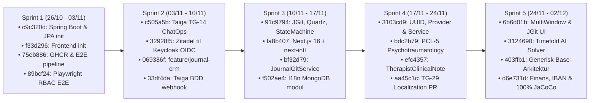

| Sprint & Periode | Centrale Git Commits (`backend` / `frontend` / `api`) | Leveret Funktionalitet & Arkitektur |
| :--- | :--- | :--- |
| **Sprint 1**<br>*(26. okt – 03. nov 2026)* | `c9c320d`, `ca5872f`, `f33d296`, `75eb886`, `89bcf24` | Opstart af Spring Boot backend, første Gherkin `.feature`-filer til journal/psykotraumatologi, Dockerisering, GHCR container-pipeline og Playwright E2E-skelet. |
| **Sprint 2**<br>*(03. nov – 10. nov 2026)* | `46c4615`, `c505a5b` (`TG-14`), `d70ec4f`, `32928f5` (#37), `40af524`, `069386f` (#21), `33df4da` | Opsætning af Traefik reverse proxy, arkitektonisk skift fra Zitadel til **Keycloak 24 OIDC** med dedikeret PostgreSQL `auth-db`, samt automatisk Taiga-til-GitHub BDD synkronisering. |
| **Sprint 3**<br>*(10. nov – 17. nov 2026)* | `91c9794`, `a17c344` (`TG-26`), `6446311` (`TG-27`), `fa8b407`, `94e7ed1`, `bf32d79`, `f502ae4`, `21432bf` | Skift fra Vite SPA til **Next.js 16 BFF med NextAuth**, implementering af [`JournalGitService`](file:///z:/home/work/projects/api/backend/src/main/java/com/platform/features/journal/JournalFeature.java) (Eclipse JGit), `I18nService` (MongoDB) og Docker Compose secrets-håndtering. |
| **Sprint 4**<br>*(17. nov – 24. nov 2026)* | `3103cd9`, `1d0e7e9`, `bdc2b79`, `efc4357`, `5f22640`, `d118282`, `aa45c1c` (`TG-29`), `28bf632` | Gennemførelse af UUID-identitet på tværs af entiteter, oprettelse af [`PsychotraumatologyFeature`](file:///z:/home/work/projects/api/backend/src/main/java/com/platform/features/psychotraumatology/PsychotraumatologyFeature.java) (PCL-5), fortrolige terapeutnoter (`TherapistClinicalNote`) og fuld flersproget lokaliserings-pipeline. |
| **Sprint 5**<br>*(24. nov – 02. dec 2026)* | `44238d6`, `6b6d01b`, `2da49bb`, `3124690`, `5c87524`, `403ffb1`, `7d6e4ea`, `d6e731d`, `9668e6a` | **Videreudvikling & Arkitektonisk Konsolidering:** `TherapistMultiWindowWorkspace` med JGit diff-tidslinje, **Timefold Solver** booking-optimering, **Konsolideret 2-Fils Core (`BaseDomainCore` + `BaseWebCore`) & Vertical Slice Arkitektur (`features/*`)**, finansmodul (KillBill/Fineract + IBAN) og **100% JaCoCo coverage gate**. |

---

# 2. Gitgraph – Branch-strategi og JGit Patient-versionsstyring

### 2.1 Gitgraph over projektets udviklings-branches (GitHub)
Nedenstående Mermaid `gitGraph` viser den faktiske branch- og merge-historik (`main`, `dev` og `feature/*`-branches) fra projektets Git-repositories:

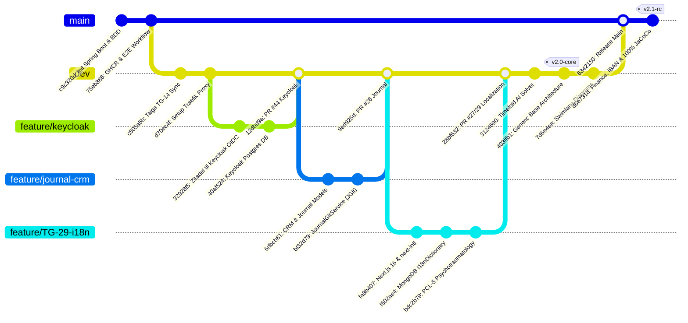

### 2.2 Gitgraph over Eclipse JGit Patient-Journal Branches (`JournalGitService`)
Ud over kildekodens Git-historik bruger systemet **Eclipse JGit** internt i [`JournalGitService.java`](file:///z:/home/work/projects/api/backend/src/main/java/com/platform/service/JournalGitService.java) til at versionsstyre hver enkelt klients journalfil (`./journal-repo/<patientId>.md`) med logiske branches (`[Branch: main]`, `[Branch: trauma-therapy]`, `[Branch: private-diary]`), som styres via klientens `ClientTherapistHandshake.allowedBranches`:

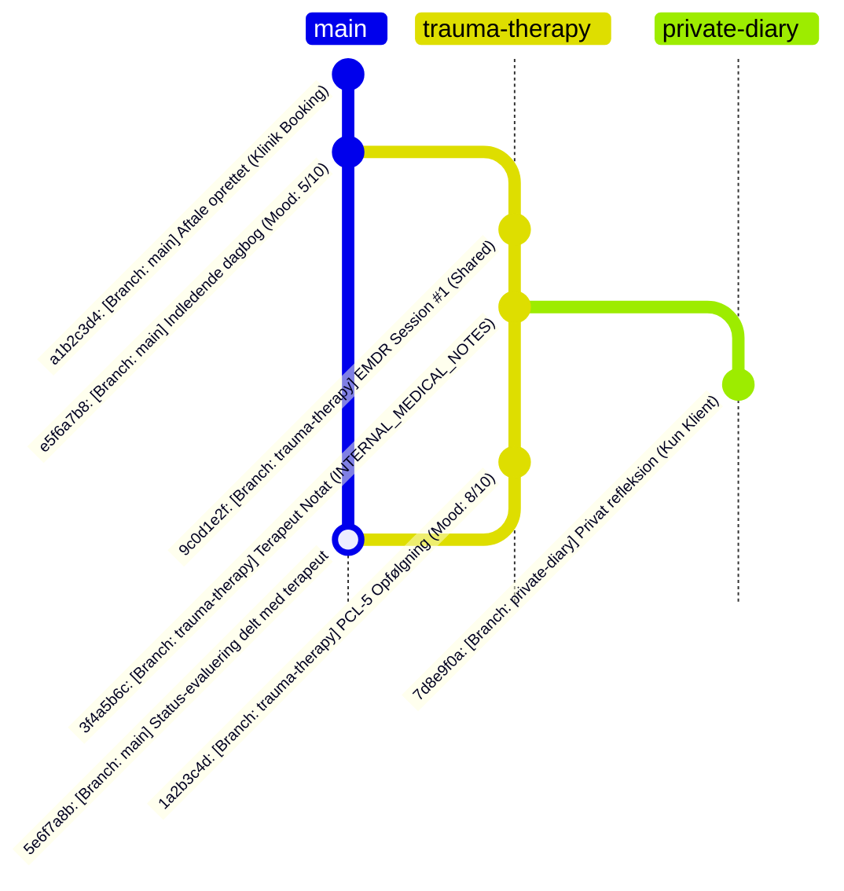

---

# 3. Flowchart / Pipeline – CI/CD, GitHub SDLC & Outside-In BDD/TDD

Dette flowchart viser den samlede udviklings-, SDLC- og CI/CD-pipeline på tværs af [`.github/workflows/sdlc-commit-sync.yml`](file:///z:/home/work/projects/api/.github/workflows/sdlc-commit-sync.yml), [`.github/workflows/sdlc-verify-and-sync.yml`](file:///z:/home/work/projects/api/.github/workflows/sdlc-verify-and-sync.yml), [`pom.xml`](file:///z:/home/work/projects/api/backend/pom.xml) og [`docker-publish.yml`](file:///z:/home/work/projects/api/backend/.github/workflows/docker-publish.yml):

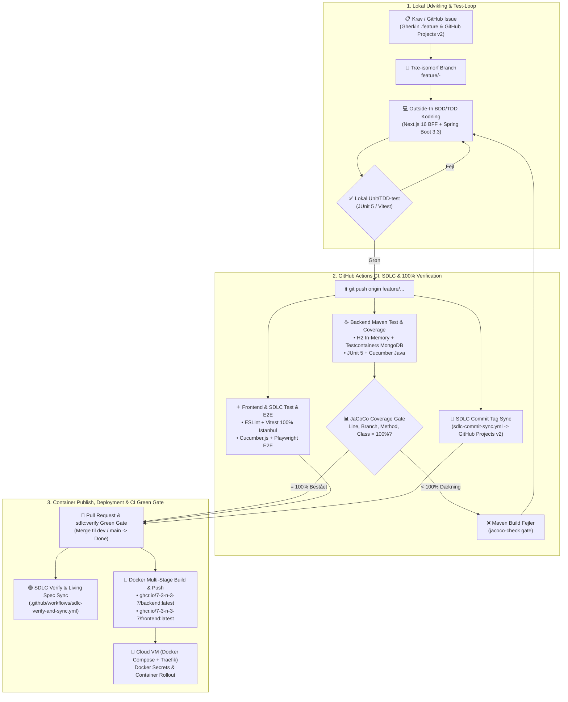

---

# 4. ER-Diagram (`erDiagram`) – PostgreSQL, MongoDB & JGit

Nedenstående Mermaid `erDiagram` modellerer det komplette databaseskema på tværs af **PostgreSQL (`business-db`)**, **MongoDB (`integrate_mongo`)** og **Eclipse JGit (`journal-repo`)**:

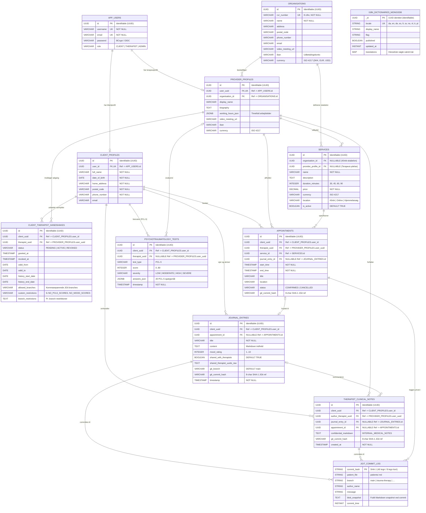

---

# 5. State Machine Diagrammer (`stateDiagram-v2`)

### 5.1 State Machine: Samtykke-Handshake & Granulær Journaladgang
Dette `stateDiagram-v2` viser tilstandsmaskinen for `ClientTherapistHandshake` i [`ClinicPlatformService.java`](file:///z:/home/work/projects/api/backend/src/main/java/com/platform/service/ClinicPlatformService.java) og [`JournalService.java`](file:///z:/home/work/projects/api/backend/src/main/java/com/platform/service/JournalService.java):

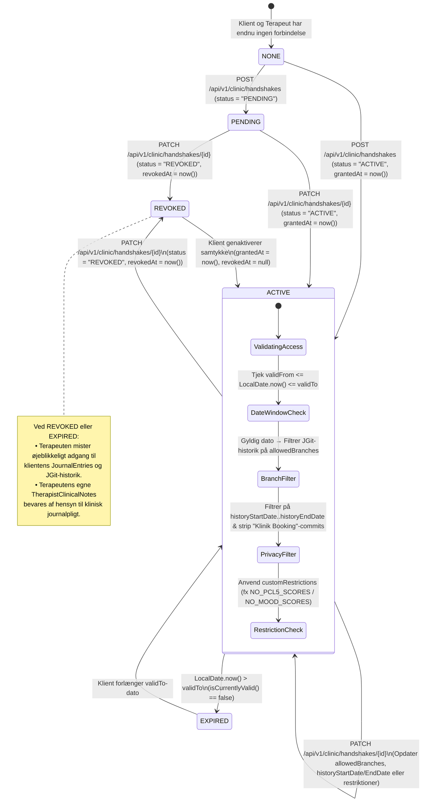

### 5.2 State Machine: Aftale-livscyklus (Appointment) & Finansiel Bogføring (KillBill/Fineract)
Dette `stateDiagram-v2` viser samspillet mellem [`AppointmentService.java`](file:///z:/home/work/projects/api/backend/src/main/java/com/platform/service/AppointmentService.java) og [`FinanceService.java`](file:///z:/home/work/projects/api/backend/src/main/java/com/platform/service/FinanceService.java):

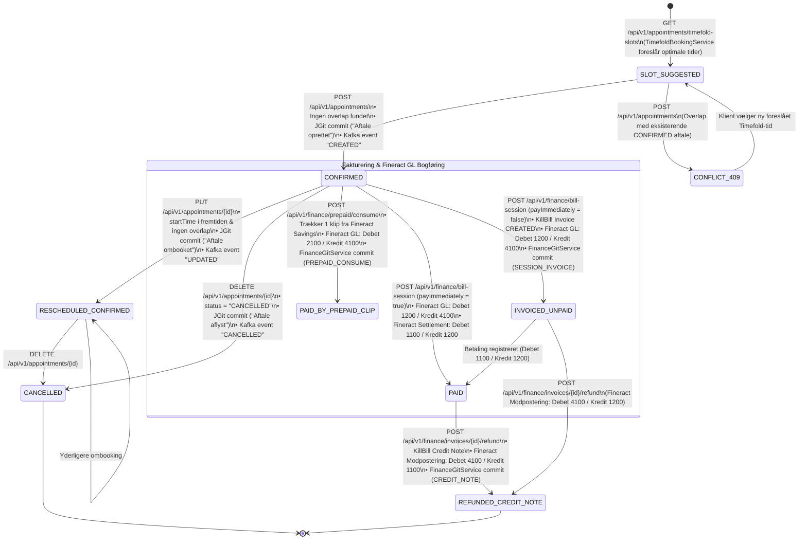

---

# 6. Aktivitets- og Sekvensdiagrammer pr. Domæne (Alle 7 Domæner)

Herunder følger et **Aktivitetsdiagram (Swimlane Flowchart)** og et **Sekvensdiagram** for hvert af de 7 domæner:
1. `core`
2. `appointment`
3. `clinic-platform`
4. `i18n`
5. `journal`
6. `psychotraumatology`
7. `user`

---

## 6.1 Domæne 1: `core` & Vertical Slices (`BaseDomainCore` + `BaseWebCore` $\leftrightarrow$ `baseDomainCore.ts` + `baseUiCore.tsx` $\rightarrow$ `<FeatureName>Feature`)

De tre arkitekturdiagrammer [`docs/diagrams/core-and-slice-class-diagram.puml`](file:///z:/home/work/projects/api/docs/diagrams/core-and-slice-class-diagram.puml), [`docs/diagrams/fullstack-symmetry.puml`](file:///z:/home/work/projects/api/docs/diagrams/fullstack-symmetry.puml) og [`docs/diagrams/double-loop-tdd.mmd`](file:///z:/home/work/projects/api/docs/diagrams/double-loop-tdd.mmd) viser den komplette **1:1 Full-Stack Arkitektursymmetri** mellem Java 21 / Spring Boot 3-backend'en og TypeScript 5 / React 19-frontend'en:
- **Backend Core (`com.platform.core`) $\leftrightarrow$ Frontend Core (`src/core`):**
  - [`BaseDomainCore.java`](file:///z:/home/work/projects/api/backend/src/main/java/com/platform/core/BaseDomainCore.java) $\leftrightarrow$ [`baseDomainCore.ts`](file:///z:/home/work/projects/api/frontend/src/core/baseDomainCore.ts) (Ren domænekerne uden UI/React-afhængigheder: `HasId<ID>`, `PageResponse<T>`, `ErrorCode`, `ProblemDetail`, `FrontendDomainException`, `DomainGuard` og den abstrakte `BaseApiService<DTO, ID>`).
  - [`BaseWebCore.java`](file:///z:/home/work/projects/api/backend/src/main/java/com/platform/core/BaseWebCore.java) $\leftrightarrow$ [`baseUiCore.tsx`](file:///z:/home/work/projects/api/frontend/src/core/baseUiCore.tsx) (Præsentations-supertype: den generiske `useBaseCrud<DTO, ID>` hook, RFC 7807 `<ProblemAlert />` med deterministiske `data-testid`-attributter samt `<PortalWorkspaceShell />`).
- **7 1:1 Vertical Feature Slices (`com.platform.features.<name>` $\leftrightarrow$ `src/features/<name>/<Name>Feature.tsx`):**
  - [`AppointmentFeature.java`](file:///z:/home/work/projects/api/backend/src/main/java/com/platform/features/appointment/AppointmentFeature.java) $\leftrightarrow$ [`AppointmentFeature.tsx`](file:///z:/home/work/projects/api/frontend/src/features/appointment/AppointmentFeature.tsx)
  - [`ClinicPlatformFeature.java`](file:///z:/home/work/projects/api/backend/src/main/java/com/platform/features/clinic/ClinicPlatformFeature.java) $\leftrightarrow$ [`ClinicPlatformFeature.tsx`](file:///z:/home/work/projects/api/frontend/src/features/clinic/ClinicPlatformFeature.tsx)
  - [`FinanceFeature.java`](file:///z:/home/work/projects/api/backend/src/main/java/com/platform/features/finance/FinanceFeature.java) $\leftrightarrow$ [`FinanceFeature.tsx`](file:///z:/home/work/projects/api/frontend/src/features/finance/FinanceFeature.tsx)
  - [`I18nFeature.java`](file:///z:/home/work/projects/api/backend/src/main/java/com/platform/features/i18n/I18nFeature.java) $\leftrightarrow$ [`I18nFeature.tsx`](file:///z:/home/work/projects/api/frontend/src/features/i18n/I18nFeature.tsx)
  - [`JournalFeature.java`](file:///z:/home/work/projects/api/backend/src/main/java/com/platform/features/journal/JournalFeature.java) $\leftrightarrow$ [`JournalFeature.tsx`](file:///z:/home/work/projects/api/frontend/src/features/journal/JournalFeature.tsx)
  - [`PsychotraumatologyFeature.java`](file:///z:/home/work/projects/api/backend/src/main/java/com/platform/features/psychotraumatology/PsychotraumatologyFeature.java) $\leftrightarrow$ [`PsychotraumatologyFeature.tsx`](file:///z:/home/work/projects/api/frontend/src/features/psychotraumatology/PsychotraumatologyFeature.tsx)
  - [`UserFeature.java`](file:///z:/home/work/projects/api/backend/src/main/java/com/platform/features/user/UserFeature.java) $\leftrightarrow$ [`UserFeature.tsx`](file:///z:/home/work/projects/api/frontend/src/features/user/UserFeature.tsx)

### 6.1.0 Klassediagram – 1:1 Full-Stack Symmetri (`docs/diagrams/fullstack-symmetry.puml`)

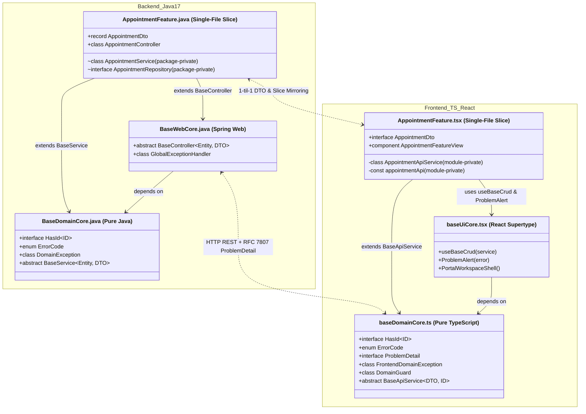

### 6.1.1 Aktivitetsdiagram – `core` & RFC 7807 `ProblemDetail`

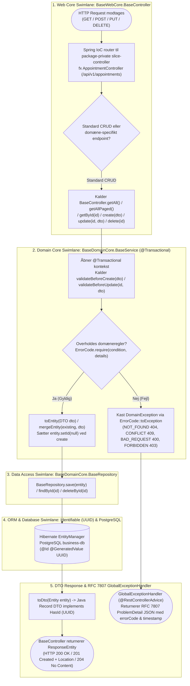

### 6.1.2 Sekvensdiagram – `core` (`BaseController` $\rightarrow$ `BaseService` $\rightarrow$ `ErrorCode` / `ProblemDetail`)

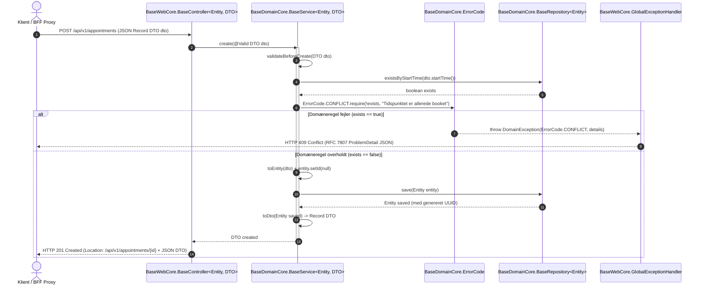

---

## 6.2 Domæne 2: `appointment` (Booking, Timefold AI Solver, JGit, Redis & Kafka)

### 6.2.1 Aktivitetsdiagram – `appointment`

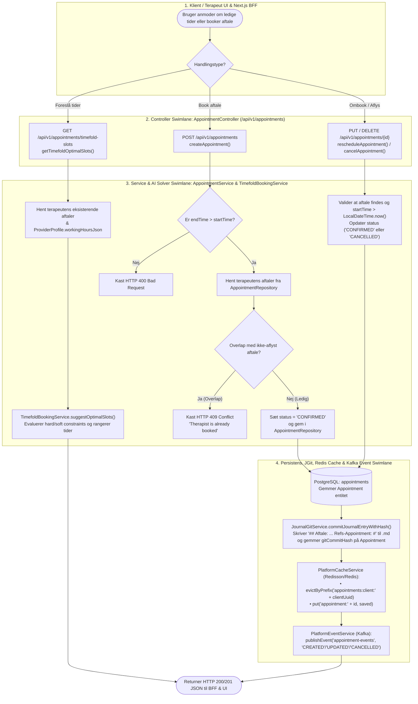

### 6.2.2 Sekvensdiagram – `appointment`

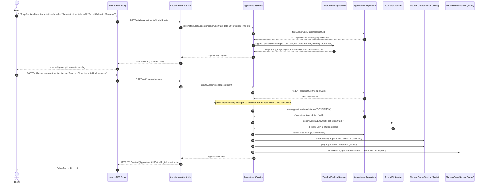

---

## 6.3 Domæne 3: `clinic-platform` (Klinik-markedsplads, CVR/IBAN Onboarding, Ydelser & Handshakes)

### 6.3.1 Aktivitetsdiagram – `clinic-platform`

```mermaid
flowchart TD
    subgraph BFF_Lane["1. Frontend & Next.js BFF (/api/backend/clinic/*)"]
        A1(["Bruger tilgår Klinik-markedsplads,\nOnboarder med CVR/IBAN eller opretter Ydelse/Handshake"]) --> A2{"Operation?"}
    end

    subgraph Ctrl_Lane["2. Controller Swimlane: ClinicPlatformController (/api/v1/clinic)"]
        A2 -- "Terapeut Onboarding" --> C1["POST /api/v1/clinic/therapist-onboarding\nonboardTherapist(payload, auth)"]
        A2 -- "Opret Ydelse (Service)" --> C2["POST /api/v1/clinic/services\ncreateService(payload, auth)"]
        A2 -- "Opret/Opdater Handshake" --> C3["POST / PATCH /api/v1/clinic/handshakes\ncreateOrUpdateHandshake() / updateHandshakeStatus()"]
    end

    subgraph Svc_Lane["3. Service Swimlane: ClinicPlatformService"]
        C1 --> S1{"Er cvrNumber udfyldt?"}
        S1 -- "Nej" --> E400_1["Kast HTTP 400: CVR number is required"]
        S1 -- "Ja" --> S2["Find eller opret Organisation(cvr, orgName)\nValider ISO-4217 currency & gem IBAN/adresse"]
        S2 --> S3["Find eller opret ProviderProfile for userUuid\nTilknyt Organisation, arbejdstider, IBAN & videoMeetingUrl"]

        C2 --> S4["getMissingProfileFields(provider, org, clientProfile)\nKontrollerer: CVR, orgName, arbejdstider, adresse, postnr., tlf., IBAN"]
        S4 --> S5{"Mangler obligatoriske profilfelter?"}
        S5 -- "Ja" --> E400_2["Kast HTTP 400 Bad Request:\n'Du kan ikke oprette en service før du har udfyldt: ...'"]
        S5 -- "Nej" --> S6["Opret eller deduplikér Service entitet\nmed varighed, pris, valuta og lokation"]

        C3 --> S7["Berig Handshake med clientName, therapistName & organisationName\nSæt status (ACTIVE/PENDING/REVOKED), validFrom/To,\nhistoryStartDate/EndDate, allowedBranches & customRestrictions"]
    end

    subgraph DB_Keycloak["4. Repository, PostgreSQL & Keycloak Rolle-Sync"]
        S3 --> D1[("PostgreSQL:\norganisations & provider_profiles")]
        D1 --> D2["Next.js BFF (route.ts):\nsyncKeycloakTherapistRole(userUuid)\nTildeler 'therapist' realm-rolle i Keycloak"]
        S6 --> D3[("PostgreSQL: services")]
        S7 --> D4[("PostgreSQL: client_therapist_handshakes")]
    end
```

### 6.3.2 Sekvensdiagram – `clinic-platform`

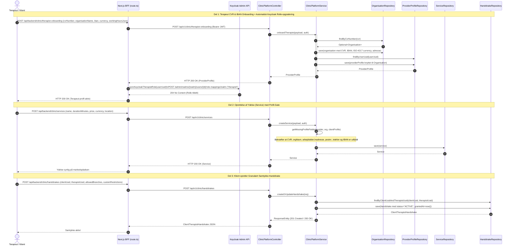

---

## 6.4 Domæne 4: `i18n` (Flersproget Lokalisering, MongoDB Dictionaries & BFF Cache)

### 6.4.1 Aktivitetsdiagram – `i18n`

```mermaid
flowchart TD
    subgraph Startup["1. Applikationsopstart (Seeding)"]
        S0(["Spring Boot Startup"]) --> S1["ClinicDatabaseInitializer.run()\nSeeder standard-ordbøger (da, en, de, es, fr)\ni MongoDB hvis de ikke findes"]
    end

    subgraph ClientFlow["2. Offentligt Læse-flow (Next.js UI & BFF Cache)"]
        U1(["Bruger skifter sprog i LanguageSwitcher\neller indlæser side"]) --> U2["GET /api/backend/i18n/{locale}"]
        U2 --> U3["Next.js BFF Proxy videresender til\nI18nController.getDictionary(locale)"]
        U3 --> U4{"Findes locale i MongoDB?"}
        U4 -- "Ja" --> U5["Returner translations Map<String, Object>"]
        U4 -- "Nej (Fallback)" --> U6["Hent fallback-sprog ('en' eller 'da')\nog sæt header X-Locale-Fallback: true"]
        U5 --> U7["Next.js BFF sætter HTTP Header:\nCache-Control: public, max-age=300, stale-while-revalidate=600"]
        U6 --> U7
    end

    subgraph AdminFlow["3. Admin Redigerings- & Klonings-flow (/api/v1/i18n)"]
        A1(["Admin opretter nyt sprog eller\nopdaterer oversættelsesnøgle"]) --> A2{"Handling?"}
        A2 -- "PUT /api/v1/i18n/{locale}/{key}" --> A3["I18nService.updateTranslation(locale, key, value)\nSplitter punktum-nøgler (fx 'nav.dashboard.title')\ntil indlejrede LinkedHashMap-noder"]
        A2 -- "POST /api/v1/i18n/locales" --> A4["I18nService.createOrUpdateLocale()\nKloner evt. manglende nøgler fra reference-sprog\nvia flattenMap() + updateNestedMap()"]
        A2 -- "GET /api/v1/i18n/locales?ref=da" --> A5["I18nService.getLocaleSummaries('da')\nBeregner translatedCount, missingCount & completionPct (%)"]
        A3 --> M1[("MongoDB: i18n_dictionaries\nGemmer dokument med updatedAt = Instant.now()")]
        A4 --> M1
        A5 --> M1
    end
```

### 6.4.2 Sekvensdiagram – `i18n`

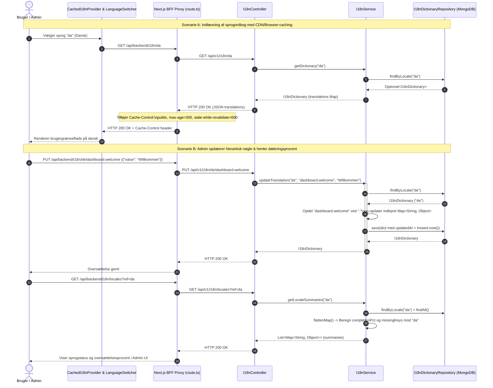

---

## 6.5 Domæne 5: `journal` (Klientjournal, Fortrolige Terapeutnoter & JGit Privatlivsfilter)

### 6.5.1 Aktivitetsdiagram – `journal`

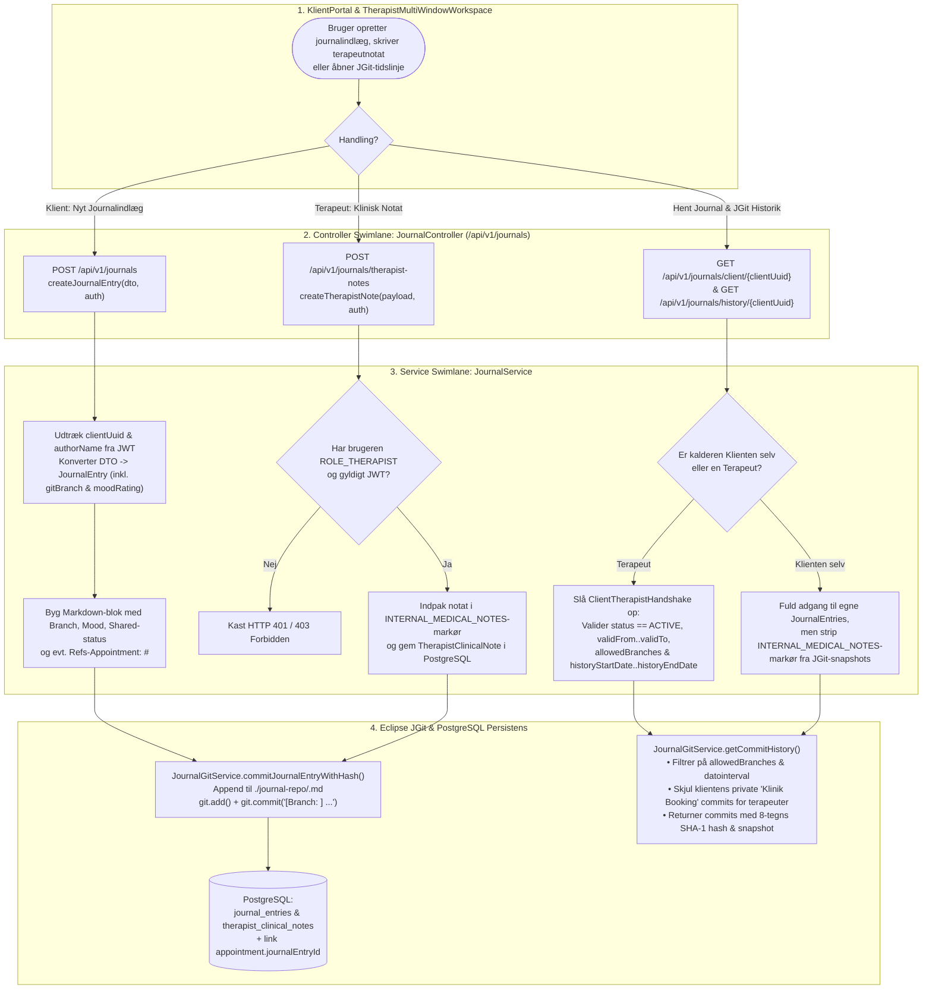

### 6.5.2 Sekvensdiagram – `journal`

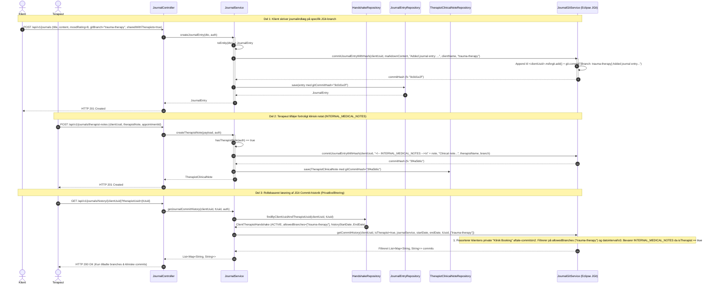

---

## 6.6 Domæne 6: `psychotraumatology` (PCL-5 Traumescreening & Selvbetjenings-autorisation)

### 6.6.1 Aktivitetsdiagram – `psychotraumatology`

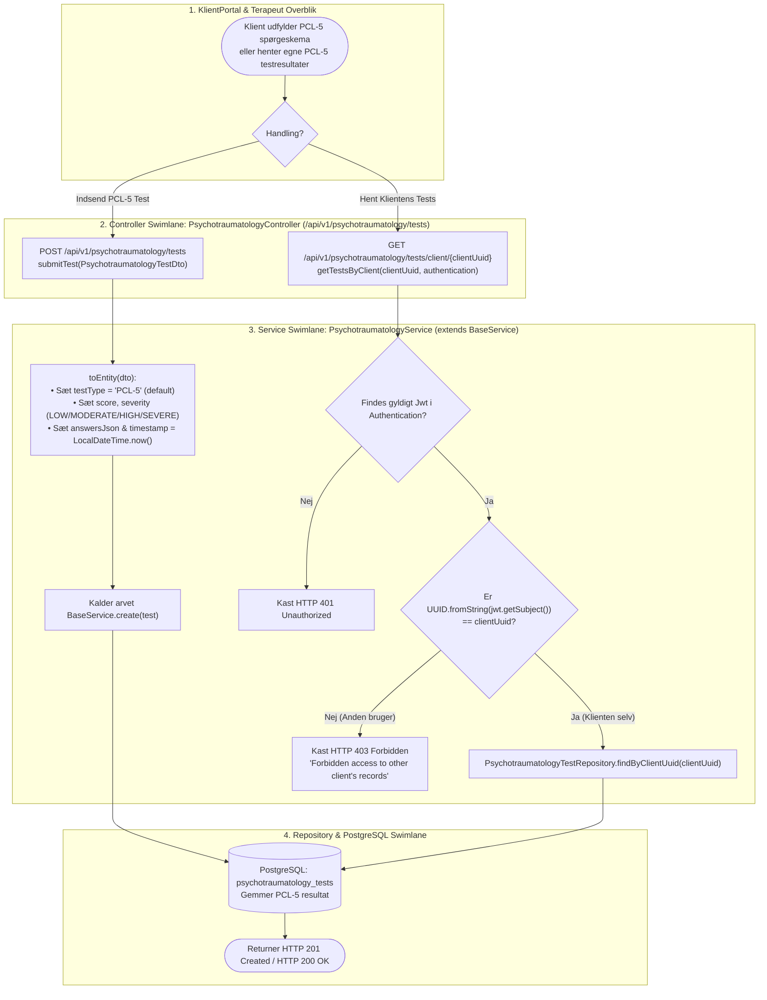

### 6.6.2 Sekvensdiagram – `psychotraumatology`

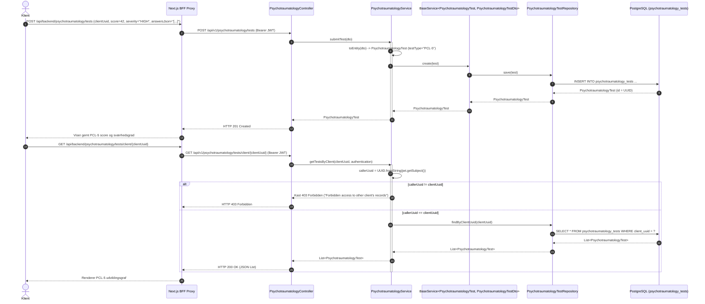

---

## 6.7 Domæne 7: `user` (Brugeroprettelse, Keycloak OAuth2 JWT Filter & Profil)

### 6.7.1 Aktivitetsdiagram – `user`

```mermaid
flowchart TD
    subgraph SecurityLane["1. Sikkerhedsfilter: SecurityConfig (Spring Security OAuth2 Resource Server)"]
        R0(["Indgående HTTP Request"]) --> R1{"Offentligt endpoint\n(/api/public/**, /api/v1/i18n/*, /api/users)?"}
        R1 -- "Nej (Beskyttet)" --> R2["Valider Bearer JWT mod Keycloak JWKS\neller verificerede BFF X-Auth-* headers"]
        R2 --> R3["jwtAuthenticationConverter()\nUdtræk realm_access.roles -> ROLE_<rolle>"]
        R1 -- "Ja (PermitAll / Auth)" --> R4["Videresend til Controller"]
        R3 --> R4
    end

    subgraph CtrlLane["2. Controller Swimlane: UserController (/api/users) & ProfileController (/api/v1/profile)"]
        R4 --> C1{"Endpoint?"}
        C1 -- "POST /api/users" --> C2["UserController.createUser(@Valid UserRequestDto)\nValiderer @NotBlank username/password & role"]
        C1 -- "GET /api/v1/profile" --> C3["ProfileController.getUserProfile(authentication)\nUdtrækker sub, preferred_username, email & roller fra Jwt"]
    end

    subgraph SvcLane["3. Service Swimlane: UserService (extends BaseService<UserEntity, UserDto>)"]
        C2 --> S1{"Matcher role\n'^(CLIENT|ADMIN|THERAPIST)$'?"}
        S1 -- "Nej" --> E400_Role["Kast IllegalArgumentException('invalid role')\n-> HTTP 400 Bad Request"]
        S1 -- "Ja" --> S2{"Findes username allerede?\nuserRepository.existsByUsername()"}
        S2 -- "Ja" --> E400_Dup["Kast IllegalArgumentException('username already exists')\n-> HTTP 409 / 400"]
        S2 -- "Nej" --> S3["toEntity(request) -> UserEntity\nuserRepository.save(user)"]
    end

    subgraph DBLane["4. Repository & PostgreSQL Swimlane"]
        S3 --> D1[("PostgreSQL: app_users\nGemmer UserEntity med UUID")]
        D1 --> D2["Map til UserResponseDto (id, username, role)\n(Udelader password i respons)"]
        D2 --> Out(["Returner HTTP 201 Created / HTTP 200 OK"])
        C3 --> Out
    end
```

### 6.7.2 Sekvensdiagram – `user`

```mermaid
sequenceDiagram
    autonumber
    actor User as Ny Bruger / Klient
    participant BFF as Next.js Auth / BFF
    participant Sec as SecurityConfig (OAuth2 FilterChain)
    participant UCtrl as UserController (/api/users)
    participant PCtrl as ProfileController (/api/v1/profile)
    participant USvc as UserService
    participant URepo as UserRepository
    participant DB as PostgreSQL (app_users)

    Note over User,DB: Del 1: Oprettelse af bruger med rolle- og dubletvalidering
    User->>BFF: Indsender registreringsformular (username, password, role="CLIENT")
    BFF->>Sec: POST /api/users (JSON UserRequestDto)
    Sec->>UCtrl: createUser(@Valid UserRequestDto)
    activate UCtrl
    UCtrl->>USvc: createUser(request)
    activate USvc
    USvc->>USvc: Valider role.matches("^(CLIENT|ADMIN|THERAPIST)$")
    USvc->>URepo: existsByUsername(request.username)
    URepo->>DB: SELECT COUNT(*) FROM app_users WHERE username = ?
    DB-->>URepo: false (ledigt)
    URepo-->>USvc: false
    USvc->>USvc: toEntity(request) -> UserEntity
    USvc->>URepo: save(userEntity)
    URepo->>DB: INSERT INTO app_users (id, username, password, role) VALUES (UUID, ...)
    DB-->>URepo: UserEntity (savedUser)
    URepo-->>USvc: savedUser
    USvc->>USvc: Map til UserResponseDto (id, username, role)
    USvc-->>UCtrl: UserResponseDto
    deactivate USvc
    UCtrl-->>BFF: HTTP 201 Created (UserResponseDto uden password)
    deactivate UCtrl
    BFF-->>User: Bruger oprettet

    Note over User,DB: Del 2: Hentning af autentificeret brugerprofil via JWT
    User->>BFF: GET /api/backend/profile (Med NextAuth Session Cookie)
    BFF->>Sec: GET /api/v1/profile (Authorization: Bearer <Keycloak JWT>)
    Sec->>Sec: Valider JWT signatur & udtræk GrantedAuthorities
    Sec->>PCtrl: getUserProfile(Authentication)
    PCtrl->>PCtrl: Læs Jwt claims (sub, preferred_username, email, realm_access.roles)
    PCtrl-->>BFF: HTTP 200 OK (Profil-metadata JSON)
    BFF-->>User: Viser brugerprofil og aktiv rolle i UI
```

---

# 7. Frontend 1:1 Symmetri, Dual-App Separation of Concerns (`apps/landing` vs. `apps/dashboard`) & RBAC (`RoleGuard`)

For at opnå 1:1 arkitektonisk symmetri mellem Java 17 / Spring Boot 3-backenden og TypeScript 5 / React 19-frontenden — samtidig med at **Zero-Trust Separation of Concerns (SoC)** håndhæves på klientsiden — er frontenden struktureret som en **Hybrid Dual-App & BFF Arkitektur** med en **2-Fils Core (`baseDomainCore.ts` + `baseUiCore.tsx`)**, et offentligt **Zero-Trust Gateway-lag (`authGateway.ts` + `LandingFeature.tsx`)** i [`apps/landing`](file:///z:/home/work/projects/api/frontend/apps/landing/src/App.tsx) (Port 5173) og en **Rollebaseret Portal (`AuthProvider` + `<RoleGuard />`)** i [`apps/dashboard`](file:///z:/home/work/projects/api/frontend/apps/dashboard/src/App.tsx) (Port 5174) samt Next.js 16 BFF (Port 3000).

### 7.1 Arkitekturdiagram: Dual-App SoC (`apps/landing` vs. `apps/dashboard`) & RBAC (`RoleGuard`)

```mermaid
flowchart TB
    subgraph PublicZone["Offentlig Zone — apps/landing (Port 5173, Zero-Trust Gateway)"]
        LandingUI["LandingFeature.tsx\n(<LandingFeatureView />)\nOffentlig værdipræsentation & Login-knapper"]
        Gateway["authGateway.ts (Pure TypeScript)\nAuthGateway.buildLoginUrl(roleHint)\nAuthGateway.initiateLogin(roleHint)\nIngen React- eller CRUD-imports!"]
        LandingUI -->|"onClick -> initiateLogin('CLIENT' | 'PROVIDER' | 'MANAGEMENT')"| Gateway
    end

    subgraph ProtectedZone["Beskyttet Portal-Zone — apps/dashboard (Port 5174) & Next.js 16 BFF (:3000)"]
        subgraph Core2File["2-Fils Core (src/core/)"]
            DomainCore["baseDomainCore.ts (Pure TypeScript)\n• HasId<ID>, UserRole, AuthenticatedUser\n• expandRoleAliases() & matchesAnyRole()\n• ErrorCode & ProblemDetail (RFC 7807)\n• FrontendDomainException & DomainGuard\n• abstract BaseApiService<DTO, ID>"]
            UiCore["baseUiCore.tsx (React Supertype)\n• <AuthProvider /> & useAuth()\n• <RoleGuard allowed={[...]} />\n• useBaseCrud<DTO, ID>()\n• <ProblemAlert /> & <PortalWorkspaceShell />"]
            UiCore -->|depends on| DomainCore
        end

        subgraph Slices["Rolle-isolerede Vertical Feature Slices (src/features/*)"]
            BookingSlice["BookingFeature.tsx & AppointmentFeature.tsx\n<RoleGuard allowed={['CLIENT', 'PROVIDER']}>\nModule-private AppointmentApiService"]
            JournalSlice["JournalFeature.tsx\n<RoleGuard allowed={['PROVIDER']}>\nModule-private JournalApiService + JGit diff"]
            MgmtSlice["ManagementFeature.tsx\n<RoleGuard allowed={['MANAGEMENT']}>\nModule-private ManagementApiService (KPI & Audit)"]
            DomainSlices["Øvrige 1:1 Domæne-Slices:\n• ClinicPlatformFeature.tsx\n• FinanceFeature.tsx\n• I18nFeature.tsx\n• PsychotraumatologyFeature.tsx\n• UserFeature.tsx"]
        end

        BookingSlice --> UiCore
        JournalSlice --> UiCore
        MgmtSlice --> UiCore
        DomainSlices --> UiCore
    end

    subgraph BackendZone["Spring Boot 3 Backend (:8080 / :8081)"]
        JavaWeb["BaseWebCore.java\nBaseController<Entity, DTO>\nGlobalExceptionHandler (RFC 7807)"]
        JavaDomain["BaseDomainCore.java\nBaseService<Entity, DTO>\nDomainGuard & ErrorCode"]
        JavaWeb --> JavaDomain
    end

    Gateway -->|"HTTP Redirect\nhttp://localhost:5174/?roleHint=..."| UiCore
    DomainCore <-->|"HTTP REST / JSON + Bearer JWT\n+ RFC 7807 ProblemDetail"| JavaWeb
```

### 7.2 Sekvensdiagram: Fra Offentlig Gateway (`apps/landing`) til Rollebeskyttet Vertical Slice (`<RoleGuard />`)

```mermaid
sequenceDiagram
    autonumber
    actor Visitor as Besøgende / Bruger
    participant Landing as LandingFeatureView (Port 5173)
    participant AG as AuthGateway (authGateway.ts)
    participant Portal as Dashboard App / AuthProvider (Port 5174 / :3000)
    participant RG as <RoleGuard allowed={[...]} /> (baseUiCore.tsx)
    participant Slice as Vertical Slice (fx ManagementFeature / JournalFeature)
    participant Svc as Module-Private <Name>ApiService (baseDomainCore.ts)
    participant API as Spring Boot 3 Backend (/api/v1/*)

    Visitor->>Landing: Klikker på "Virksomhedsledelse Login" (eller Klient / Terapeut)
    Landing->>AG: AuthGateway.initiateLogin("MANAGEMENT")
    AG->>AG: buildLoginUrl("MANAGEMENT") -> "http://localhost:5174/?roleHint=MANAGEMENT"
    AG-->>Portal: window.location.assign(...) -> OIDC / Session-kontekst
    Portal->>Portal: AuthProvider initialiserer user.roles (synkroniserer PROVIDER<->THERAPIST, MANAGEMENT<->ADMIN)
    Portal->>RG: Render <RoleGuard allowed={["MANAGEMENT"]}> omkring <ManagementFeatureView />
    alt matchesAnyRole(user.roles, allowed) == false (fx CLIENT forsøger adgang til Management/Journal)
        RG-->>Visitor: Viser <p data-testid="forbidden-notice">Adgang nægtet</p> (Zero data leakage)
    else matchesAnyRole(user.roles, allowed) == true
        RG->>Slice: Mount <ManagementFeatureView /> -> useBaseCrud(managementService)
        Slice->>Svc: create(dto) -> validateBeforeCreate(dto) via DomainGuard
        Svc->>API: POST /api/backend/management/kpis (Authorization: Bearer <token>)
        API-->>Svc: HTTP 201 Created (ManagementKpiDto) eller HTTP 4xx/5xx RFC 7807 ProblemDetail
        Svc-->>Slice: Opdaterer React state eller viser <ProblemAlert />
        Slice-->>Visitor: Viser opdateret KPI-liste / Journal / Kalender
    end
```

