# Hovedopgave – Rapportskabelon & Kravspecifikation (Efterår 2026)

> **Forslag til eksamensbevis-titel (jf. Slide 29):**  
> *Udvikling af en sikret klinisk journaliserings-, booking- og markedspladsplatform (Integrate Platform / EduJournal) med Spring Boot 3, Next.js 16 BFF, Keycloak OIDC og uforanderlig revisionslogning via Eclipse JGit*

---

## Indholdsfortegnelse

- [0. Overblik: Tidsplan, Eksamen, Formalia & Kompetenceniveauer (Slide 1–10, 29–33)](#0-overblik-tidsplan-eksamen-formalia--kompetenceniveauer-slide-110-2933)
  - [0.1 Vigtige datoer og Roadmap (Slide 3)](#01-vigtige-datoer-og-roadmap-slide-3)
  - [0.2 Sammenhæng mellem praktik og hovedopgave (Slide 4)](#02-sammenhæng-mellem-praktik-og-hovedopgave-slide-4)
  - [0.3 Vejledning i hovedopgaveforløbet (Slide 5)](#03-vejledning-i-hovedopgaveforløbet-slide-5)
  - [0.4 Eksamen – Præsentation og individuel eksamination (Slide 6)](#04-eksamen--præsentation-og-individuel-eksamination-slide-6)
  - [0.5 Rapportformalia – Normalsider for 1–4 studerende (Slide 7)](#05-rapportformalia--normalsider-for-14-studerende-slide-7)
  - [0.6 Kompetenceniveauer & Blooms Taksonomi (Slide 8–9)](#06-kompetenceniveauer--blooms-taksonomi-slide-89)
  - [0.7 Hovedopgavens to hovedsøjler: Produkt & Proces (Slide 10)](#07-hovedopgavens-to-hovedsøjler-produkt--proces-slide-10)
- [DEL I: PRODUKTDEL (Slide 11–22)](#del-i-produktdel-slide-1122)
  - [1. Forord (Slide 12)](#1-forord-slide-12)
  - [2. Indledning / Introduktion (Slide 13)](#2-indledning--introduktion-slide-13)
  - [3. Virksomheden – Introduktion & Behovsanalyse (Slide 14–15)](#3-virksomheden--introduktion--behovsanalyse-slide-1415)
    - [3.1 Introduktion til virksomheden og organisatorisk struktur (Slide 14)](#31-introduktion-til-virksomheden-og-organisatorisk-struktur-slide-14)
    - [3.2 Behovsanalyse, forretningsdomæne og mål (Slide 15)](#32-behovsanalyse-forretningsdomæne-og-mål-slide-15)
  - [4. Kravspecifikation (Slide 16)](#4-kravspecifikation-slide-16)
    - [4.1 Produktets omfang (Scope – In/Out of Scope)](#41-produktets-omfang-scope--inout-of-scope)
    - [4.2 Funktionelle krav (Use Cases & User Stories m. Gherkin Acceptance Criteria)](#42-funktionelle-krav-use-cases--user-stories-m-gherkin-acceptance-criteria)
    - [4.3 Non-funktionelle krav (Målbare kvalitetskrav)](#43-non-funktionelle-krav-målbare-kvalitetskrav)
  - [5. Valg af teknologi(er) (Slide 17)](#5-valg-af-teknologier-slide-17)
  - [6. Valg af arkitektur – Systemdesign (Slide 18)](#6-valg-af-arkitektur--systemdesign-slide-18)
  - [7. Design – Kodedesign & Databasedesign (Slide 19)](#7-design--kodedesign--databasedesign-slide-19)
    - [7.1 Designklassediagram og Design Patterns](#71-designklassediagram-og-design-patterns)
    - [7.2 Sekvensdiagram for centrale strømme](#72-sekvensdiagram-for-centrale-strømme)
    - [7.3 Databasedesign (Polyglot Persistence)](#73-databasedesign-polyglot-persistence)
  - [8. Implementering (Slide 20)](#8-implementering-slide-20)
    - [8.1 Generisk lagdelt CRUD-arkitektur m. Spring IoC & Reflection](#81-generisk-lagdelt-crud-arkitektur-m-spring-ioc--reflection)
    - [8.2 Uforanderlig revisionslogning og privatlivsfiltrering med Eclipse JGit](#82-uforanderlig-revisionslogning-og-privatlivsfiltrering-med-eclipse-jgit)
    - [8.3 Next.js 16 Backend-For-Frontend (BFF) Proxy & Keycloak OIDC synkronisering](#83-nextjs-16-backend-for-frontend-bff-proxy--keycloak-oidc-synkronisering)
  - [9. Test (Slide 21)](#9-test-slide-21)
    - [9.1 Systematisk teststrategi jf. SDLC V-Modellen](#91-systematisk-teststrategi-jf-sdlc-v-modellen)
    - [9.2 Automatiseret Code Coverage Gate (JaCoCo) og Test Cases](#92-automatiseret-code-coverage-gate-jacoco-og-test-cases)
  - [10. Evaluering og Konklusion på Produktdelen (Slide 22)](#10-evaluering-og-konklusion-på-produktdelen-slide-22)
- [DEL II: PROCESDEL (Slide 23–28)](#del-ii-procesdel-slide-2328)
  - [11. Projektkarakteristika – Boehm & Turner Analyse (Slide 24)](#11-projektkarakteristika--boehm--turner-analyse-slide-24)
  - [12. Valg af udviklingsmetode og teknikker (Slide 25)](#12-valg-af-udviklingsmetode-og-teknikker-slide-25)
  - [13. Dokumentation af processen – Tidsmæssigt overblik (Slide 26)](#13-dokumentation-af-processen--tidsmæssigt-overblik-slide-26)
  - [14. Refleksion over processen – Retrospektiv & Feedforward (Slide 27–28)](#14-refleksion-over-processen--retrospektiv--feedforward-slide-2728)
- [DEL III: GENERELLE KRAV, TOMMELFINGERREGLER & KILDEBRUG (Slide 29–33)](#del-iii-generelle-krav-tommelfingerregler--kildebrug-slide-2933)
  - [15. Tjekliste til alle afsnit, layout og AI/kildehenvisning](#15-tjekliste-til-alle-afsnit-layout-og-aikildehenvisning)
- [16. Litteraturliste (Skabelon)](#16-litteraturliste-skabelon)
- [17. Bilagsoversigt (Skabelon)](#17-bilagsoversigt-skabelon)

---

# 0. Overblik: Tidsplan, Eksamen, Formalia & Kompetenceniveauer (Slide 1–10, 29–33)

> [!IMPORTANT]
> **Formål med dette overbliksafsnit:**  
> Dette for-afsnit samler alle administrative krav, datoer, sidetalsregler, eksamensrammer og bedømmelseskriterier fra alle 33 slides i *Hovedopgave kick-off efterår 2026.pptx*, så du/I løbende kan krydstjekke rapporten mod uddannelsens krav.

### 0.1 Vigtige datoer og Roadmap (Slide 3)

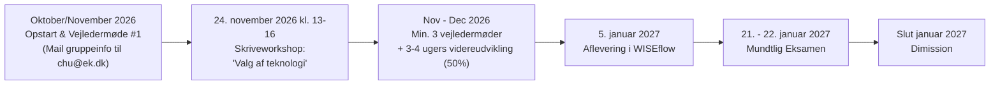

- **Skriveworkshop:** 24. november kl. 13:00–16:00 (fokus på afsnittet *"Valg af teknologi"*, jf. Slide 3 & 17 – nærmere besked via Moodle).
- **Aflevering:** **5. januar** i WISEflow.
- **Mundtlig eksamen:** **21. – 22. januar**.
- **Dimission:** Slut januar (besked via receptionen).
- **Fortrolighed:** Alle rapporter er i udgangspunktet fortrolige. Erhvervsakademiet underskriver **ikke** NDA'er (Slide 3).
- **Grupperegistrering & Matchmaking (Slide 33):** Send mail til koordinator (`chu@ek.dk`) med oplysning om, hvem der skriver hovedopgave sammen (af hensyn til eksamensplanlægning).

### 0.2 Sammenhæng mellem praktik og hovedopgave (Slide 4)
- Det anbefales at bruge praktikprojektet som fundament for hovedopgaven.
- **Krav om videreudvikling i hovedopgaveforløbet:**
  - Der **skal** ske fortsat videreudvikling i hovedopgaveperioden med fokus på elementer, der styrker hovedopgaven (produkt og/eller proces).
  - **Omfang:** Ca. **3–4 uger på 50% tid** parallelt med rapportskrivningen.
  - Indhold og omfang aftales med vejleder og **skal afgrænses præcist i Forordet** (Slide 12).

### 0.3 Vejledning i hovedopgaveforløbet (Slide 5)
- **Minimumskrav til møder (vejlederens ansvar at indkalde/sikre afholdelse):**
  1. **Indledende afklarende møde** (vejleder indkalder).
  2. **Minimum 3 vejledermøder** med feedback på rapportudkast, som er fremsendt på forhånd.
- **Vigtige spilleregler:**
  - Du/I kan **ikke** forvente, at vejlederen læser de samme afsnit flere gange.
  - Afstem altid ved hvert møde: ambitionsniveau, hvad der skrives til næste gang, præcis hvad der ønskes feedback på (inkl. færdighedsgrad i %), dato for næste møde og deadline for fremsendelse af udkast.

### 0.4 Eksamen – Præsentation og individuel eksamination (Slide 6)

| Del af eksamen | Varighed (1 studerende) | Varighed (Gruppe: $N$ studerende) | Indhold og fokus |
| :--- | :--- | :--- | :--- |
| **1. Præsentation** | **10 minutter** | **$10 \times N$ minutter samlet** *(fx 2 pers. = 20 min, 3 pers. = 30 min)* | Præsentation af projektet, arkitektur, udvalgte løsninger og proces. |
| **2. Individuel eksamination** | **20 minutter** *(inkl. votering)* | **20 minutter pr. studerende** *(inkl. votering)* | Faglig diskussion mellem studerende og eksaminator. Der eksamineres **ikke** i hele uddannelsens pensum, men i de dele af pensum, der er relevante for projektet. |

### 0.5 Rapportformalia – Normalsider for 1–4 studerende (Slide 7)
- **Formel:** Max **20 sider + 10 sider pr. studerende** (hvor **1 normalside = 2.400 tegn inkl. mellemrum**).
- **Minimumsgrænse (tommelfingerregel):** En rapport på væsentligt mindre end **75% af max-sidetallet** vil typisk være problematisk.

| Antal studerende | Max antal normalsider (2.400 tegn) | Anbefalet minimum (~75% af max) | Max antal tegn i alt |
| :---: | :---: | :---: | :---: |
| **1 studerende** | **Max 30 normalsider** | Ca. 22,5 – 30 normalsider | 72.000 tegn |
| **2 studerende** | **Max 40 normalsider** | Ca. 30 – 40 normalsider | 96.000 tegn |
| **3 studerende** | **Max 50 normalsider** | Ca. 37,5 – 50 normalsider | 120.000 tegn |
| **4 studerende** | **Max 60 normalsider** | Ca. 45 – 60 normalsider | 144.000 tegn |

### 0.6 Kompetenceniveauer & Blooms Taksonomi (Slide 8–9)
Rapporten skal demonstrere de højere taksonomiske niveauer (**Analysere**, **Vurdere/Evaluere**, **Skabe**) frem for blot at være beskrivende (**Huske**, **Forstå**).

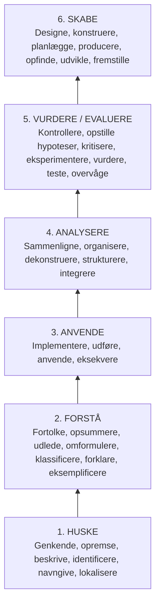

### 0.7 Hovedopgavens to hovedsøjler: Produkt & Proces (Slide 10)
Hovedopgaven skal opfylde læringsmålene i [Studieordning for datamatiker (2024)](https://www.ek.dk/media/5y3ohqiy/dat_cba_studieordning_2024.pdf) og består af to hoveddele:
1. **Produktdel:** Dokumentation af det udviklede produkt samt refleksion over opfyldelse af produktmål (kravspecifikation).
2. **Procesdel:** Dokumentation af de procesaktiviteter, som var nødvendige for at udvikle produktet, samt vurdering af hensigtsmæssigheden af processen.

---

# DEL I: PRODUKTDEL (Slide 11–22)

---

## 1. Forord (Slide 12)

> [!NOTE]
> **Krav til Forord (Slide 4 & Slide 12):**
> - Angiv hvilken rapport der er tale om, samt uddannelse (*Datamatiker AK, Erhvervsakademi København / cphbusiness Lyngby*).
> - Angiv deltagere (1 eller flere studerende), vejleder og udarbejdelsesperiode.
> - **KRITISK ved kombination af praktik og hovedopgave:** Der skal være en **præcis angivelse af, hvad der er udviklet hvornår** (hvad der blev lavet under praktikforløbet vs. hvad der er videreudviklet i de 3–4 uger under hovedopgaveforløbet).

### Udkast til tekst (Klar til tilpasning)

Denne rapport udgør den afsluttende hovedopgave på datamatikeruddannelsen ved Erhvervsakademi København (cphbusiness Lyngby), udarbejdet i perioden `[indsæt startdato, fx november 2026]` til `5. januar 2027`.

#### Deltagere og vejledning
- **Udarbejdet af:**
  - `[Navn 1, Studiekortnr. / Mail]` *(Behov for 1 studerende – tilføj flere rækker ved gruppeaflevering)*
  - `[Evt. Navn 2, Studiekortnr. / Mail]`
- **Vejleder:** `[Indsæt vejleders navn]`
- **Praktik-/Samarbejdsvirksomhed:** Institut for Folkesundhed / IFHI (`Integrate Platform` / `EduJournal`)

#### Afgrænsning mellem praktikforløb og hovedopgaveforløb (Jf. Slide 4 & 12)
På datamatikeruddannelsen har jeg lært den klassiske arkitektur **MVC** (*Model, View, Controller*), lagdelingen **Entity, DTO, DAO, Service, Controller og Route** samt objektorienteringens fire grundsøjler (**Inheritance, Abstraction, Encapsulation og Polymorphism**). Som mit eget arkitektoniske afsæt fra studiet valgte jeg at sætte **Encapsulation** (indkapsling) i centrum ved at samle fælles opførsel i en superklasse med abstrakte baseklasser for alle seks lag for at minimere boilerplate-kode. Projektet bygger videre på det systemfundament, der blev påbegyndt under praktikforløbet, og er i hovedopgaveperioden videreudviklet i et omfang svarende til ca. 3–4 uger på 50% tid parallelt med rapportskrivningen:

| Fase / Periode | Udviklede moduler, arkitektur og procesaktiviteter |
| :--- | :--- |
| **Praktikperiode**<br>*(August – Oktober 2026)* | • Etablering af containeriseret infrastruktur med Traefik v3.1, Keycloak OIDC, PostgreSQL, MongoDB, Redis og Kafka ([`docker-compose.yml`](file:///z:/home/work/projects/api/docker-compose.yml)).<br>• Kerne-entiteter for klinik-markedsplads, terapeuter, klienter, samtykke-handshakes (`ClientTherapistHandshake`) og booking.<br>• Grundlæggende Next.js 16 / React 19 frontend med NextAuth BFF-proxy ([`route.ts`](file:///z:/home/work/projects/api/frontend/src/app/api/backend/%5B...path%5D/route.ts)) og flersproget `next-intl` understøttelse. |
| **Hovedopgaveperiode (Videreudvikling)**<br>*(November – December 2026)* | • **Konsolideret 2-Fils Core & Vertical Slice Arkitektur:** Refaktorering og konsolidering af hele kerne-infrastrukturen til **to statiske container-klasser** ([`BaseDomainCore.java`](file:///z:/home/work/projects/api/backend/src/main/java/com/platform/core/BaseDomainCore.java) uden afhængigheder til `org.springframework.web` / `jakarta.servlet`, og [`BaseWebCore.java`](file:///z:/home/work/projects/api/backend/src/main/java/com/platform/core/BaseWebCore.java) med RFC 7807 `ProblemDetail` fejlhåndtering) samt **Package-by-Feature Vertical Slices** (`com.platform.features.<feature>.<FeatureName>Feature.java`) med striks `package-private` indkapsling af Repository, Service og Controller.<br>• **Uforanderlig JGit Revisionshistorik & Branch-filtrering:** Udvidelse af [`JournalGitService`](file:///z:/home/work/projects/api/backend/src/main/java/com/platform/features/journal/JournalFeature.java) med branch-isolering, snapshot-diffing og rollebaseret privatlivsfiltrering mellem klient og terapeut.<br>• **Finans- og optimeringsmoduler:** Integration af IBAN/valuta-håndtering, fakturerings-ledger ([`FinanceFeature.java`](file:///z:/home/work/projects/api/backend/src/main/java/com/platform/features/finance/FinanceFeature.java)) og skemaoptimering med Timefold Solver ([`AppointmentFeature.java`](file:///z:/home/work/projects/api/backend/src/main/java/com/platform/features/appointment/AppointmentFeature.java)).<br>• **Kvalitetssikring:** Udbygning af Double-Loop BDD/TDD testsuiter (Cucumber + JUnit 5 + Playwright i 1:1 pakke-spejling) til 98% JaCoCo coverage gate ([`pom.xml`](file:///z:/home/work/projects/api/backend/pom.xml)). |

---

## 2. Indledning / Introduktion (Slide 13)

> [!NOTE]
> **Krav til Introduktion (Slide 13 & Slide 29):**
> - **Introduktion til projektet / Abstract:** Kort præsentation af problemfeltet og løsningen.
> - **Formålet med rapporten:** Hvad ønsker du/I at dokumentere, analysere og vurdere?
> - **Strukturen af rapporten (Læsevejledning):** Gennemgang af rapportens opbygning i Produktdel og Procesdel.
> - **Målgruppe for rapporten:** F.eks. vejleder, censor, medstuderende på datamatikeruddannelsen samt softwareudviklere i virksomheden.
> - **Beskrivelse af anvendelsen af AI:** Eksplicit deklaration af, hvordan generative AI-værktøjer er anvendt i henhold til EK's retningslinjer (Slide 13 & 31).

### 2.1 Introduktion til projektet (Abstract)
I den digitale sundheds- og terapisektor stilles der skærpede krav til datasikkerhed, sporbarhed, samtykkestyring (GDPR) og sammenhængende brugeroplevelser på tværs af klienter, terapeuter og klinikorganisationer. Dette projekt omhandler udviklingen og videreudviklingen af **Integrate Platform / EduJournal** – en full-stack sundheds-, journaliserings- og klinikmarkedspladsplatform.

### 2.2 Formål og målgruppe
Formålet med denne rapport er dels at dokumentere og vurdere de teknologiske, arkitektoniske og designmæssige valg bag platformen (**Produktdelen**), dels at analysere og evaluere den anvendte Outside-In BDD/TDD-udviklingsproces (**Procesdelen**).  
Rapportens målgruppe er eksaminator, censor og fagfæller med kendskab til moderne objektorienteret softwareudvikling, distribuerede systemer og agile metoder på datamatikerniveau.

### 2.3 Læsevejledning og rapportstruktur
Rapporten er inddelt i to hoveddele:
- **Del I – Produktdel (Kapitel 3–10):** Gennemgår virksomheden og dens forretningsmæssige behov (Kapitel 3), funktionelle og non-funktionelle krav (Kapitel 4), teknologivalg (Kapitel 5), systemarkitektur (Kapitel 6), kodedesign (Kapitel 7), udvalgte kodeimplementeringer (Kapitel 8), systematisk test (Kapitel 9) samt produktevaluering (Kapitel 10).
- **Del II – Procesdel (Kapitel 11–14):** Analyserer projektets karakteristika ud fra Boehm & Turners model (Kapitel 11), diskuterer valg af udviklingsmetode og teknikker (Kapitel 12), dokumenterer tidsforløbet og sprintplanlægningen (Kapitel 13) og afrunder med et samlet retrospektiv og feedforward (Kapitel 14).

### 2.4 Anvendelse af Generativ AI i projektet og rapporten (Jf. Slide 13 & Slide 31)
I overensstemmelse med Erhvervsakademi Københavns retningslinjer for [Brug af AI ved eksamen](https://mit.ek.dk/studiehaandbog/eksamensregler#under-strongeksamenstrong-brug-af-ai-herunder-chatgpt-eller-lign-item) og [Rammer for brug af GenAI](https://mit.ek.dk/studieviden/generativ-ai#retningslinjer) har generativ AI været anvendt som sparringspartner til:
1. **Udviklingsstøtte:** Sparring om fejlfinding i konfigurationsfiler, generering af boilerplate-kode samt testdata til BDD-scenarier.
2. **Rapportstruktur og sproglig korrektur:** Strukturering af afsnitsdispositioner og sproglig korrektur. Al faglig analyse, arkitekturbeslutninger, vurderinger og konklusioner er udarbejdet og verificeret selvstændigt af forfatteren/forfatterne, og der er ikke foretaget udeklareret afskrift af AI-genereret tekst.

---

## 3. Virksomheden – Introduktion & Behovsanalyse (Slide 14–15)

> [!NOTE]
> **Krav til Virksomhedsafsnittet (Slide 14, 15 & 29):**
> - **Afsnitsindledning:** Formål, struktur og læsevejledning for kapitlet (Slide 29).
> - **Introduktion til virksomheden (Slide 14):** Præsentation af praktikvirksomheden og/eller kunden samt relevante organisatoriske strukturer.
> - **Behovsanalyse (Slide 15):**
>   - *Forståelse af forretningsdomænet:* Illustreret med f.eks. **Domænemodel** eller **Aktivitetsdiagram**.
>   - *Forretningsmæssige problemstillinger:* Hvilke konkrete problemer løser IT-systemet? (Ineffektive arbejdsgange, dårlig datahåndtering, manglende samarbejdsværktøjer, manuelle processer, eksterne vilkår/GDPR).
>   - *Mål og resultater:* Opdelt i **Økonomiske mål**, **Operationelle mål** og **Kundemæssige mål**.
> - **Delkonklusion (Slide 29):** Kort opsummering af forretningsbehovene, som leder direkte videre til kravspecifikationen i Kapitel 4.

### 3.1 Introduktion til virksomheden og organisatorisk struktur (Slide 14)
`[Beskriv virksomheden her – fx IFHI / klinikplatformens organisatoriske kontekst, interessenter (klienter, selvstændige terapeuter, klinikejere med CVR-organisationer og administratorer) samt nuværende IT-landskab.]`

### 3.2 Behovsanalyse, forretningsdomæne og mål (Slide 15)

#### Forretningsmæssige problemstillinger og udfordringer
Inden projektets igangsættelse var arbejdsgangene præget af følgende udfordringer:
1. **Fragmenteret datahåndtering og manglende revisionsspor:** Klienters dagbogsnotater, terapeuters fortrolige kliniske noter og psykotraumatologiske tests (PCL-5) blev håndteret i adskilte systemer uden kryptografisk/versionsstyret ændringshistorik.
2. **Manuelle arbejdsgange ved samtykke og booking:** Manglende digitalt samtykke-handshake mellem klient og terapeut gjorde det vanskeligt at styre præcis, hvornår en terapeut har læseadgang til en klients journal, og hvilke tidsintervaller/forgreninger der deles.
3. **Sikkerheds- og compliance-krav (GDPR):** Behov for striks adskillelse mellem klientens private aftale-/dagbogsdata og terapeutens interne medicinske noter (`INTERNAL_MEDICAL_NOTES`).

#### Forretningsdomæne – Domænemodel
Nedenstående domænemodel (konverteret fra projektets [`domain-model.puml`](file:///z:/home/work/projects/api/infrastructure/diagrams/domain-model.puml)) illustrerer de centrale forretningsbegreber og deres indbyrdes relationer:

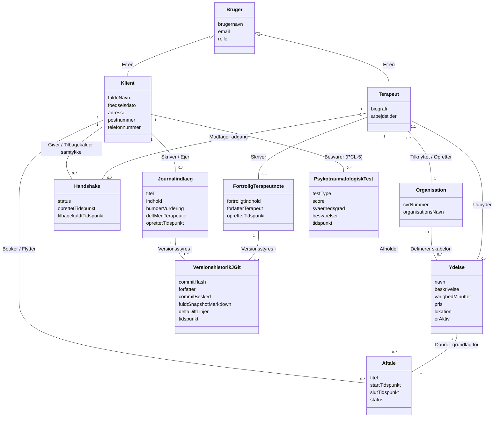

#### Forretningsmål (Økonomiske, Operationelle og Kundemæssige mål)

| Målkategori | Konkrete succeskriterier for virksomheden |
| :--- | :--- |
| **Økonomiske mål** | • Reducere administrationsomkostninger ved onboarding af nye klinikker (CVR) og automatiseret fakturering/ledger-bogføring.<br>• Skabe grundlag for skalering til internationale markeder via flersproget lokalisering (`da`, `en`, `de`, `es`, `fr`). |
| **Operationelle mål** | • Eliminere manuelle samtykke- og bookingprocesser gennem digitalt `ClientTherapistHandshake` og automatisk skemaoptimering (Timefold Solver).<br>• Sikre 100% sporbarhed af alle journalændringer gennem automatiserede JGit-commits. |
| **Kundemæssige mål** | • Øge klienternes tryghed og ejerskab over egne sundhedsdata gennem granulær delingskontrol.<br>• Give terapeuter et samlet Multi-Window arbejdsområde med tidslinje-historik og PCL-5 testoverblik. |

### 3.3 Delkonklusion
`[Opsummer kort hvordan virksomhedens behov for sikker journalisering, samtykkebaseret deling og effektiv klinikdrift direkte motiverer kravene i Kapitel 4.]`

---

## 4. Kravspecifikation (Slide 16)

> [!NOTE]
> **Krav til Krav-afsnittet (Slide 16 & Slide 29):**
> - **Produktets omfang (Scope):** Præcis afgrænsning af, hvad der er med i løsningen (*In Scope*), og hvad der ligger udenfor (*Out of Scope*).
> - **Funktionelle krav:** F.eks. præsenteret som Use Case-diagram og User Stories med målbare **Acceptance Criteria** (`Given / When / Then`).
> - **Non-funktionelle krav:** Skal være **målbare** (f.eks. svartider, testdækning $\ge 98\%$, sikkerhedsstandarder OAuth2/OIDC, tilgængelighed).
> - **Fokus på formidling:** Brug tabeller, strukturkort og diagrammer frem for blot lange brødtekster.

### 4.1 Produktets omfang (Scope – In/Out of Scope)

| In Scope (Indeholdt i hovedopgaven) | Out of Scope (Uden for projektets rammer) |
| :--- | :--- |
| • Rollebaseret adgangskontrol (RBAC) via Keycloak OIDC og Next.js BFF.<br>• Klinik-onboarding med CVR-validering, IBAN-afregningskonti og ydelseskatalog.<br>• Samtykkebaseret Handshake-flow mellem klient og terapeut.<br>• Versionsstyret klientjournal og fortrolige terapeutnoter via Eclipse JGit.<br>• Psykotraumatologisk screening (PCL-5) og flersproget i18n-administration.<br>• Generisk Base-CRUD arkitektur (`BaseEntity` $\rightarrow$ `BaseController`). | • Direkte integration til Sundhedsplatformen / MedCom-standarder i produktion.<br>• Native mobilapplikationer til iOS/Android (løsningen leveres som responsiv webapplikation).<br>• Real-time videokonsultation (WebRTC) direkte i browseren. |

### 4.2 Funktionelle krav (Use Cases & User Stories m. Gherkin Acceptance Criteria)

#### Overordnet Use Case Diagram (Jf. Slide 16)

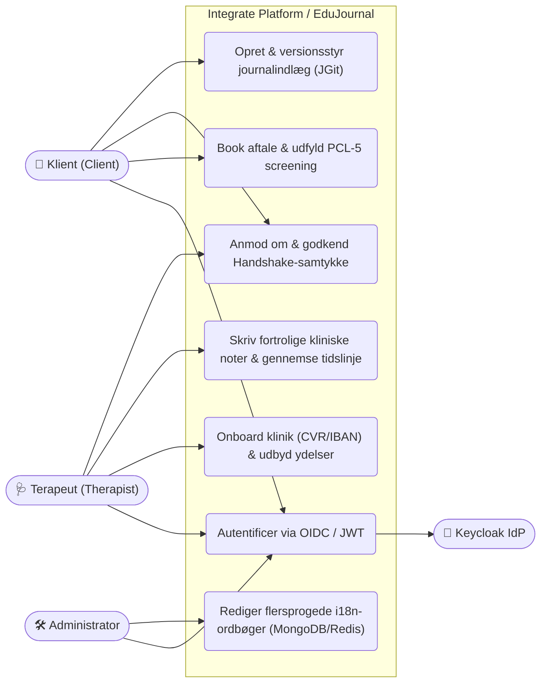

#### Udvalgt User Story Kort (Jf. skabelonen på Slide 16)

| Felt | Beskrivelse |
| :--- | :--- |
| **Title** | US-01: Generisk Base-Arkitektur & Automatiseret CRUD med Spring IoC |
| **Priority** | Høj (Arkitektonisk fundament i hovedopgaveforløbet) |
| **Estimate** | 8 Story Points |
| **User Story** | **As a** Backend Developer på EduJournal-platformen,<br>**I want** domæne-entiteter, repositories, DAO'er, DTO'er, services og controllere til at nedarve fra generiske Base-klasser koblet via Spring IoC,<br>**So that** standard CRUD, dynamisk filtrering og lifecycle-hooks afvikles ensartet gennem alle lag uden kode-duplikering. |

** tilhørende Gherkin Acceptance Criteria (fra [`generic_base_architecture.feature`](file:///z:/home/work/projects/api/backend/src/test/resources/features/generic_base_architecture.feature#L36-L50)):**

```gherkin
Scenario: AppointmentController and AppointmentService inherit generic CRUD operations from BaseController and BaseService alongside custom endpoints
  Given a valid client with UUID "5e357ca1-4913-414f-91a6-81a7de9042ab"
  And a valid therapist with UUID "4c421f46-836c-4897-8dae-ba9587473273"
  Then "AppointmentService" should inherit from BaseService
  And "AppointmentController" should inherit from BaseController
  When the client posts a new appointment booking request with:
    | title         | Generisk Base Arkitektur Samtale     |
    | startTime     | 2027-11-10T10:00:00                  |
    | endTime       | 2027-11-10T11:00:00                  |
    | therapistUuid | 4c421f46-836c-4897-8dae-ba9587473273 |
  Then the returned appointment object should contain a generated UUID
  When the client fetches the created appointment by ID via the inherited BaseController GET endpoint
  Then the inherited BaseController GET by ID response status should be 200 and title should be "Generisk Base Arkitektur Samtale"
```

### 4.3 Non-funktionelle krav (Målbare kvalitetskrav)

| ID | Kategori | Målbart krav (Kvantificeret mål) | Verifikationsmetode |
| :--- | :--- | :--- | :--- |
| **NFR-01** | **Testdækning (Maintainability)** | Både backend (**JaCoCo:** `LINE`, `BRANCH`, `INSTRUCTION`, `COMPLEXITY`, `METHOD`, `CLASS`) og frontend + SDLC-kerne (**Istanbul:** `lines`, `statements`, `functions`, `branches`) skal opretholde **minimum 98% dækning** på samtlige tællere uden undtagelsesklausuler. | Automatisk `jacoco-maven-plugin` gate i [`pom.xml`](file:///z:/home/work/projects/api/backend/pom.xml#L210-L246) samt `@vitest/coverage-istanbul` i [`vitest.config.ts`](file:///z:/home/work/projects/api/frontend/vitest.config.ts#L19-L35) verificeret af [`sdlc:verify`](file:///z:/home/work/projects/api/sdlc/core/sdlc-github.ts). |
| **NFR-02** | **Sikkerhed & Privatliv (Security)** | 100% af API-kald til beskyttede ressourcer skal valideres via OAuth2 JWT eller verificerede BFF-headers; terapeuter må have **0% adgang** til klientens private booking-commits i JGit. | Automatiserede sikkerhedstests i `SecurityTests.java` og `JournalPsychotraumatologySteps.java`. |
| **NFR-03** | **Performance & Caching** | Sprogordbøger (`GET /api/v1/i18n/{locale}`) skal caches med Redisson L2 cache og HTTP `Cache-Control: public, max-age=300, stale-while-revalidate=600`. | Verificeret via BFF proxy ([`route.ts`](file:///z:/home/work/projects/api/frontend/src/app/api/backend/%5B...path%5D/route.ts#L128-L130)) og integrationstests. |
| **NFR-04** | **Revisionssporbarhed (Auditability)** | Enhver oprettelse eller ændring af en journaltekst skal resultere i et uforanderligt Git-commit med SHA-1 hash, tidsstempel, forfatter og branch-tag. | Verificeret via `AppointmentGitVersioningTest.java` og `JournalGitService.java`. |

### 4.4 Delkonklusion
`[Opsummer hvordan de funktionelle og non-funktionelle krav stiller specifikke krav til teknologistakken, som analyseres i Kapitel 5.]`

---

## 5. Valg af teknologi(er) (Slide 17)

> [!IMPORTANT]
> **Krav til Valg af teknologi (Slide 17 – Skriveworkshop d. 24. november kl. 13-16):**
> - **Overvejelser:** Hvad er hensigtsmæssigt ift. opgaven/kravene, virksomhedens ønsker, egne læringsmål og jeres reelle **råderum** (hvad var givet på forhånd vs. hvad valgte I selv?).
> - **Tekniske alternativer:** Opstil konkrete alternativer og sammenlign **fordele og ulemper** ved hvert alternativ.
> - **Kvalificeret valg:** Begrund det endelige teknologivalg ud fra analysen af fordele og ulemper.
> - **Husk også AI-værktøjer!** Redegør også for valget af AI-assisterede udviklingsværktøjer (f.eks. Antigravity / GitHub Copilot / LLM'er).

### 5.1 Råderum og udvælgelseskriterier
`[Beskriv her hvilke teknologier virksomheden evt. ønskede på forhånd, og hvor du/I selv havde råderum til at træffe teknologivalg ud fra kravene i Kapitel 4 og egne læringsmål.]`

### 5.2 Komparativ analyse af teknologiske alternativer

| Område | Valgt teknologi i projektet | Overvejede alternativer | Fordele ved valgt teknologi | Ulemper / Trade-offs |
| :--- | :--- | :--- | :--- | :--- |
| **Backend Framework** | **Spring Boot 3.3 (Java 17 + GraalVM Native støtte)** | • .NET 8 Web API (C#)<br>• NestJS (TypeScript) | Stærk enterprise IoC-container (muliggør `GenericTypeResolver` i `BaseService`), modent økosystem for Spring Security OAuth2, JPA, MongoDB, Kafka, Redisson og direkte Java-integration med Eclipse JGit og Timefold Solver. | Højere hukommelsesforbrug på standard JVM sammenlignet med Go/Rust (mitigeret via GraalVM native-plugin). |
| **Versionsstyret Journallag** | **Eclipse JGit (Indlejret Git-kerne i Java)** | • Traditionel SQL Audit-tabel (`journal_audit_log`)<br>• Event Sourcing i EventStoreDB | Giver kryptografisk SHA-1 integritet, indbygget branch-isolering (`[Branch: ...]`), fulde Markdown-snapshots og linje-for-linje diff-historik direkte fra filsystemet uden ekstern Git-proces. | Filbaseret `.git`-lager kræver volumen-persistens på tværs af container-genstarter og egner sig bedst til tekst/Markdown frem for store binære filer. |
| **Frontend & BFF Lag** | **Next.js 16 (App Router) + React 19 + NextAuth** | • Ren SPA (Vite + React) med direkte kald til Spring Boot<br>• Angular SSR | Muliggør **Backend-For-Frontend (BFF)** sikkerhedsmønster, hvor OAuth2 access tokens holdes i krypterede server-side cookies og påhæftes i [`/api/backend/[...path]/route.ts`](file:///z:/home/work/projects/api/frontend/src/app/api/backend/%5B...path%5D/route.ts). | Øger kompleksiteten i routing-laget sammenlignet med en ren klient-SPA. |
| **Database (Polyglot)** | **PostgreSQL 16 (Relationel) + MongoDB 7 (Dokument) + Redis 7 (Cache)** | • Kun PostgreSQL (`jsonb` til i18n og transskriptioner)<br>• Kun MongoDB | PostgreSQL sikrer ACID-transaktioner for klinik-, booking- og finansdata, mens MongoDB håndterer skemafrie sprogordbøger (`i18n_dictionaries`) og medietransskriptioner, accelereret af Redisson L2-cache. | Drift og orkestrering af tre forskellige databasemotorer i Docker øger infrastrukturkompleksiteten. |
| **AI-udviklingsværktøjer** | **Google Antigravity / LLM-baseret agentisk kodning** | • Kun manuel kodning uden AI<br>• Simpel autocomplete | Accelererer skrivning af gentagne BDD step-definitions, PlantUML/Mermaid-diagrammer og refaktorering på tværs af lag. | Kræver skarp kritisk kodegennemgang og strikse automatiserede tests (98% JaCoCo gate), så AI-genereret kode aldrig kompromitterer arkitektur eller sikkerhed. |

### 5.3 Delkonklusion
`[Sammenfat det endelige teknuristak-valg og hvordan det danner grundlag for systemarkitekturen i Kapitel 6.]`

---

## 6. Valg af arkitektur – Systemdesign (Slide 18)

> [!NOTE]
> **Krav til Valg af arkitektur (Slide 18 & Slide 29):**
> - **Præsentation af alternativer:** Opstil relevante arkitekturalternativer (f.eks. Monolit vs. Microservices vs. Modulær Monolit med BFF & Polyglot Persistence) med **fordele og ulemper**.
> - **Kvalificeret valg:** Argumenter for den valgte arkitektur i lyset af teknologierne fra Kapitel 5 og kravene fra Kapitel 4.
> - **Dokumentation af arkitektur:** Vis et klart arkitektur-/deploymentdiagram.
> - *Bemærkning fra Slide 18:* Dette er typisk et relativt kort, præcist afsnit.

### 6.1 Overvejede arkitekturalternativer

| Arkitekturmønster | Fordele | Ulemper | Vurdering ift. projektet |
| :--- | :--- | :--- | :--- |
| **1. Distribueret Microservice-arkitektur** *(Separate services for Booking, Journal, Finans, i18n)* | Uafhængig skalering og udrulning af hvert domæne. | Stor netværksoverhead, distribuerede transaktioner (Saga-kompleksitet) og uforholdsmæssigt tung CI/CD for et lille udviklingsteam. | **Fravalgt** – for høj operationel kompleksitet ift. teamstørrelsen. |
| **2. Klassisk 3-lags Monolit m. direkte SPA-klient** | Simpel at udvikle og teste lokalt. | Eksponerer JWT tokens direkte i browserens `localStorage`/JavaScript og blander relationelle data med ustrukturerede sprog-/transskriptionsdokumenter. | **Fravalgt** – opfylder ikke sikkerhedskravene (BFF) og polyglot-behovene. |
| **3. Containeriseret Modulær Monolit med Next.js BFF, Edge Proxy & Polyglot Persistence (Valgt)** | Kombinerer enkelheden ved én samlet Spring Boot kerne-service (med fælles `BaseController`/`BaseService`) med netværksisolerede Docker-netværk (`public-net`, `backend-net`, `kafka-net`), BFF-tokenbeskyttelse og specialiserede datalagre. | Kræver container-orkestrering (Docker Compose) og tydelig pakke-/lagdisciplin i backend-modulet. | **Valgt** – giver optimal balance mellem sikkerhed, udviklingshastighed og skalerbarhed. |

### 6.2 Dokumentation af System- og Deployment-arkitektur
Nedenstående Mermaid-diagram (baseret på [`docker-compose.yml`](file:///z:/home/work/projects/api/docker-compose.yml) og [`deployment-diagram.puml`](file:///z:/home/work/projects/api/infrastructure/diagrams/deployment-diagram.puml)) viser systemets lagdelte container- og netværksarkitektur:

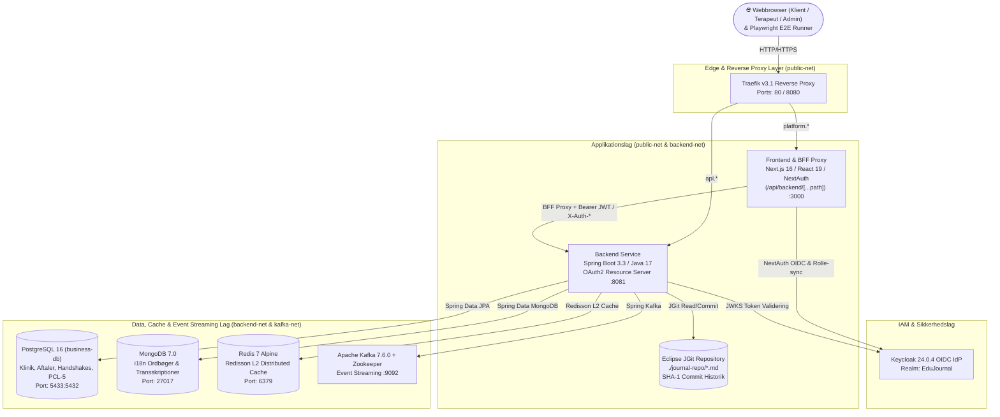

#### Udsnit af netværksisolering og Docker Secrets i [`docker-compose.yml`](file:///z:/home/work/projects/api/docker-compose.yml#L65-L94)

```yaml
  backend:
    build:
      context: ./backend
      dockerfile: Dockerfile
    container_name: backend
    ports:
    - "8081:8081"
    networks:
    - public-net
    - backend-net
    depends_on:
    - business-db
    - mongodb
    - redis
    - kafka
    labels:
    - "traefik.enable=true"
    - "traefik.http.routers.backend.rule=Host(`api.${DOMAIN:-127.0.0.1.nip.io}`)"
    - "traefik.http.services.backend.loadbalancer.server.port=8081"
    secrets:
    - spring_datasource_url
    - spring_datasource_username
    - spring_datasource_password
    - spring_data_mongodb_host
    - spring_data_redis_host
    - spring_kafka_bootstrap_servers
```

### 6.3 Delkonklusion
`[Opsummer hvordan den valgte containeriserede BFF- og lagdelte arkitektur sætter rammerne for det interne kodedesign i Kapitel 7.]`

---

## 7. Design – Kodedesign & Databasedesign (Slide 19)

> [!NOTE]
> **Krav til Design-afsnittet (Slide 19 & Slide 29):**
> - **Dokumentation af kodedesign:** Præsentation af designalternativer og **argumentation for det valgte design**.
> - **Relevante diagrammer og artefakter:**
>   - **Designklassediagram** *(NB! Slide 19 understreger: Designklassediagram med typer, metoder og synlighed – **ikke** en domænemodel!)*.
>   - **Sekvensdiagram** over centrale kald gennem lagene.
>   - **Designprincipper og Design Patterns** (f.eks. Template Method / Generics, Interceptor/Observer Pattern, BFF Proxy Pattern, Repository Pattern, DTO Pattern).
>   - **Databasedesign** (EER-diagram) og **Brugergrænsefladedesign**.

### 7.1 Designklassediagram og Design Patterns
<<<<<<< HEAD
På datamatikeruddannelsen lærte jeg den klassiske **MVC**-opdeling (*Model, View, Controller*), lagdelingen **Entity, DTO, DAO, Service, Controller og Route** samt de fire OOP-søjler (**Inheritance, Abstraction, Encapsulation og Polymorphism**). For at minimere gentagen CRUD-boilerplate på tværs af platformens domænemoduler valgte jeg bevidst at sætte **Encapsulation** (indkapsling) i centrum gennem en superklasse-arkitektur med abstrakte baseklasser for lagene. I **EduJournal** gennemgik dette studieudgangspunkt en to-trins evolution fra traditionel horisontal lagdeling til en konsolideret **2-fils Core** + **Vertical Feature Slices**, hvor `BaseService<Entity, DTO>` og `BaseController<Entity, DTO>` (+ REST-routes) stadig er `public static abstract` superklasser, mens `Entity` (`Identifiable`), `DTO` (`HasId` så Java 17 `record` kan bruges) og `DAO` (`BaseRepository<Entity>`) blev løftet til rene interfaces (spejlet 1:1 i frontenden via `BaseApiService<DTO, ID>` og `useBaseCrud()`).
=======
På datamatikeruddannelsen lærte jeg den klassiske **MVC**-opdeling (*Model, View, Controller*), lagdelingen **Entity, DTO, DAO, Service, Controller og Route** samt de fire OOP-søjler (**Inheritance, Abstraction, Encapsulation og Polymorphism**). For at minimere gentagen CRUD-boilerplate på tværs af platformens domænemoduler valgte jeg bevidst at sætte **Encapsulation** (indkapsling) i centrum gennem en superklasse-arkitektur med abstrakte baseklasser for lagene. I **EduJournal** gennemgik dette studieudgangspunkt en to-trins evolution fra traditionel horisontal lagdeling til en konsolideret **2-fils Core** + **Vertical Feature Slices**, hvor `BaseService<E, D>` og `BaseController<E, D>` (+ REST-routes) stadig er `public static abstract` superklasser, mens `Entity` (`Identifiable`), `DTO` (`HasId` så Java 17 `record` kan bruges) og `DAO` (`BaseRepository<E>`) blev løftet til rene interfaces (spejlet 1:1 i frontenden via `BaseApiService<DTO, ID>` og `useBaseCrud()`).
>>>>>>> 8e82a7d90582217c88c7b9e8f17a64ee10698757

| OOP-søjle | Anvendelse i EduJournal (Backend & Frontend) |
| :--- | :--- |
| **Encapsulation (Hovedfokus)** | `BaseDomainCore.java` (283 linjer) og `BaseWebCore.java` (183 linjer) indkapsler transaktioner, URI-bygning og RFC 7807-fejl; slice-klasser (`Repository`, `Service`, `Controller`) er `package-private` (og `ApiService` i frontend er modul-privat). |
| **Abstraction** | Abstrakte superklasser (`BaseService`, `BaseController`, `BaseApiService`) og kontrakter (`HasId`, `Identifiable`, `BaseRepository`, `Port`) skjuler infrastruktur og transportdetaljer. |
| **Inheritance** | Flad 1-niveau nedarvning fjerner CRUD-boilerplate (fx arver `BaseController` alle 6 REST-routes og `BaseService` alle 8 CRUD/opslagsmetoder, så `UserController` fylder blot 6 kodelinjer og `ManagementKpiRepository` 1 linje). |
| **Polymorphism** | `BaseController` og `useBaseCrud()` arbejder ensartet mod alle subtyper, mens *Template Method*-hooks (`toDto`, `toEntity`, `validateBeforeCreate/Update`) og `@Override` specialiserer adfærden ved runtime. |

*Kritisk trade-off (**Composition over Inheritance**):* Nedarvning begrænses bevidst til ét fladt niveau udelukkende til mekanisk CRUD-plumbing (*Template Method*), mens alt samarbejde mellem lag og på tværs af domæner bruger **komposition og konstruktør-injektion** af smalle `Port`-interfaces — dermed undgås *Fragile Base Class*-problemet.

Til den konkrete struktur blev to designalternativer analyseret:
1. **Alternativ A (Traditionel horisontal lagdeling med duplikerede Controller/Service-filer pr. entitet):** Simpelt ved 1–2 entiteter, men spreder én forretningsfunktion ud over mange pakker (*Lav Kohesionskraft*) og bryder med *DRY (Don't Repeat Yourself)* og *Open/Closed Principle (OCP)*.
2. **Alternativ B (Konsolideret 2-Fils Base-Core låst til universel `UUID` + Package-by-Feature Vertical Slices – Valgt):** Al generisk infrastruktur samles i to statiske container-filer i `core`-pakken ([`BaseDomainCore.java`](file:///z:/home/work/projects/api/backend/src/main/java/com/platform/core/BaseDomainCore.java) og [`BaseWebCore.java`](file:///z:/home/work/projects/api/backend/src/main/java/com/platform/core/BaseWebCore.java)) med universel `UUID`-identitet, mens hver forretningsfeature samles i én selvstændig Vertical Slice (`<FeatureName>Feature.java`), hvor Repository, Service og Controller er **package-private** (*Information Hiding*), og kun Entity (`implements Identifiable`) og Java `record` DTO (`implements HasId`) er `public`.

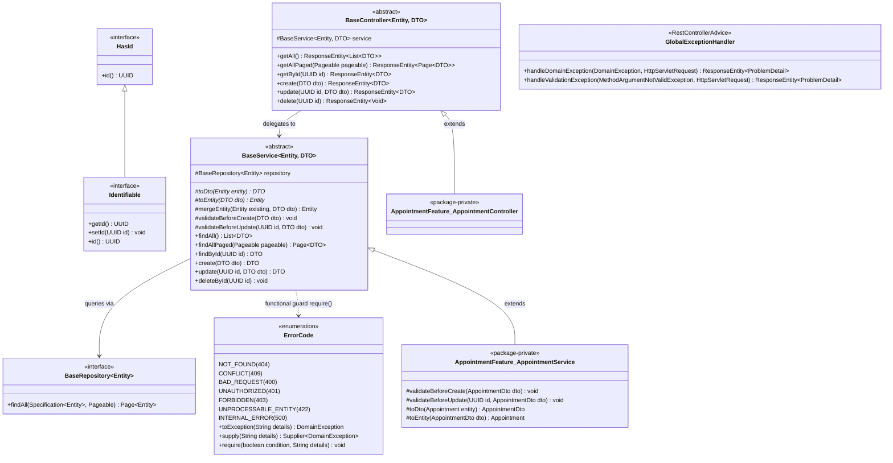

*(Se desuden det komplette PlantUML-klassediagram i [`docs/diagrams/core-and-slice-class-diagram.puml`](file:///z:/home/work/projects/api/docs/diagrams/core-and-slice-class-diagram.puml) samt [`docs/diagrams/double-loop-tdd.mmd`](file:///z:/home/work/projects/api/docs/diagrams/double-loop-tdd.mmd)).*

### 7.2 Sekvensdiagram for centrale strømme
Nedenstående sekvensdiagram viser det fulde kald-flow gennem arkitekturens lag, når en autentificeret bruger gemmer eller henter versionsstyrede journaldata gennem Next.js BFF-proxyen til Spring Boot og Eclipse JGit:

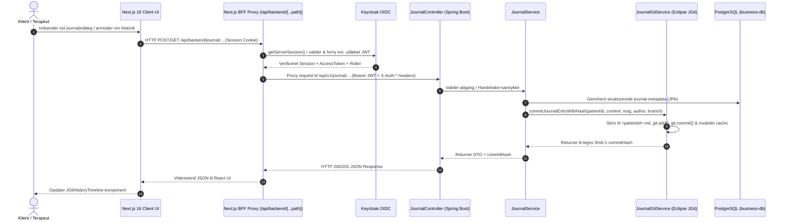

### 7.3 Databasedesign (Polyglot Persistence – Mermaid ER-Diagram)
Platformen anvender **Polyglot Persistence**, hvor relationelle kerneforretningsdata (3NF, med fælles `UUID` primærnøgle arvet fra `@MappedSuperclass BaseEntity`) gemmes i **PostgreSQL (`business-db`)**, mens hierarkiske sprogordbøger lagres i **MongoDB (`i18n_dictionaries`)**, og uforanderlig revisionshistorik lagres som SHA-1 commits i **Eclipse JGit (`./journal-repo`)**:

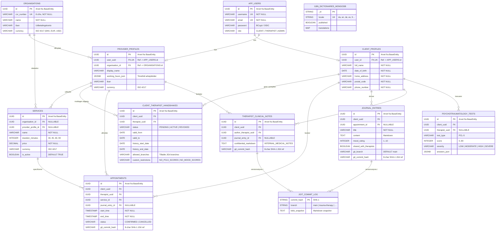

### 7.4 Tilstandsmaskine (State Machine) & JGit Branch-design
Samtykkestyringen (`ClientTherapistHandshake`) og forgreningen af patientjournaler i Eclipse JGit er modelleret som eksplicitte tilstandsmaskiner og Git-grafer:

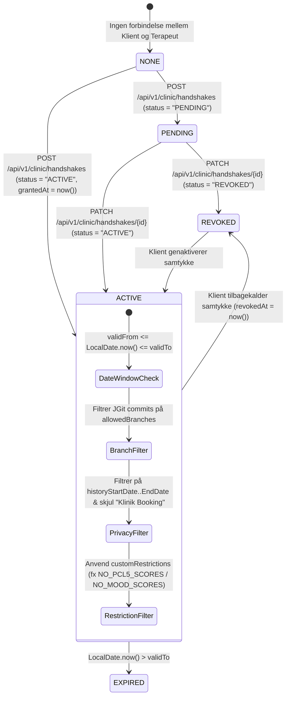

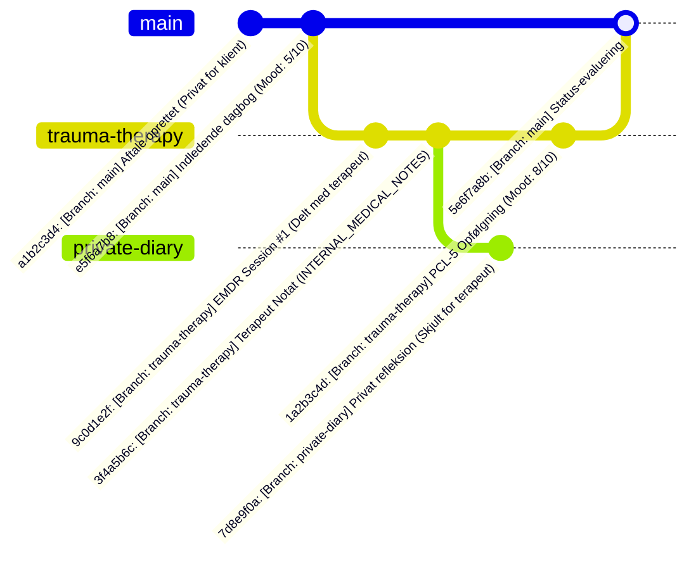

### 7.5 Domænespecifikke Aktivitets- og Sekvensdiagrammer (Alle 7 Domæner)
Alle 14 domænespecifikke aktivitets- og sekvensdiagrammer er samlet i [HOVEDOPGAVE_DIAGRAMMER.md](file:///z:/home/work/projects/api/HOVEDOPGAVE_DIAGRAMMER.md):

| Domæne / Vertical Slice | Aktivitetsdiagram & Sekvensdiagram i [HOVEDOPGAVE_DIAGRAMMER.md](file:///z:/home/work/projects/api/HOVEDOPGAVE_DIAGRAMMER.md) | Konsolideret Vertical Slice i kodebasen |
| :--- | :--- | :--- |
| **1. `core`** | Afsnit 6.1 (`BaseDomainCore` + `BaseWebCore` $\rightarrow$ `AppointmentFeature` + RFC 7807 `ProblemDetail`) | [`BaseDomainCore.java`](file:///z:/home/work/projects/api/backend/src/main/java/com/platform/core/BaseDomainCore.java), [`BaseWebCore.java`](file:///z:/home/work/projects/api/backend/src/main/java/com/platform/core/BaseWebCore.java) |
| **2. `appointment`** | Afsnit 6.2 (Booking, Timefold AI Solver, JGit commit, Redis eviction & Kafka event) | [`AppointmentFeature.java`](file:///z:/home/work/projects/api/backend/src/main/java/com/platform/features/appointment/AppointmentFeature.java) |
| **3. `clinic`** | Afsnit 6.3 (Markedsplads, CVR/IBAN Onboarding, Keycloak rolle-sync, Ydelser & Handshakes) | [`ClinicPlatformFeature.java`](file:///z:/home/work/projects/api/backend/src/main/java/com/platform/features/clinic/ClinicPlatformFeature.java) |
| **4. `i18n`** | Afsnit 6.4 (MongoDB sprogordbøger, hierarkisk nøgle-opdatering, sprog-kloning & BFF cache) | [`I18nFeature.java`](file:///z:/home/work/projects/api/backend/src/main/java/com/platform/features/i18n/I18nFeature.java) |
| **5. `journal`** | Afsnit 6.5 (Klientjournal, `INTERNAL_MEDICAL_NOTES` terapeutnoter & JGit privatlivsfiltrering) | [`JournalFeature.java`](file:///z:/home/work/projects/api/backend/src/main/java/com/platform/features/journal/JournalFeature.java) |
| **6. `psychotraumatology`** | Afsnit 6.6 (PCL-5 traumescreening og JWT `callerUuid == clientUuid` adgangskontrol) | [`PsychotraumatologyFeature.java`](file:///z:/home/work/projects/api/backend/src/main/java/com/platform/features/psychotraumatology/PsychotraumatologyFeature.java) |
| **7. `user` & `finance`** | Afsnit 6.7 (`SecurityConfig` OAuth2 JWT FilterChain, brugeroprettelse, profil & finansledger) | [`UserFeature.java`](file:///z:/home/work/projects/api/backend/src/main/java/com/platform/features/user/UserFeature.java), [`FinanceFeature.java`](file:///z:/home/work/projects/api/backend/src/main/java/com/platform/features/finance/FinanceFeature.java), [`SecurityConfig.java`](file:///z:/home/work/projects/api/backend/src/main/java/com/platform/config/SecurityConfig.java) |

### 7.6 Delkonklusion
`[Opsummer hvordan klassedesignet, design patterns (Template Method, Functional ErrorCode, Vertical Slice Encapsulation, BFF Proxy), tilstandsmaskinerne og databasedesignet realiseres i kode i Kapitel 8.]`

---

## 8. Implementering (Slide 20)

> [!NOTE]
> **Krav til Implementering (Slide 20 & Slide 29):**
> - **Kommenterede kodedele:** Vis udvalgte, kommenterede kodeudsnit – **ikke** lange ukommenterede kodelister.
> - **Fokusområder der skal dokumenteres med kodeeksempler:**
>   1. **Mestring af nye teknologier** (f.eks. Eclipse JGit API, Java 17 Records + Functional `ErrorCode`, Next.js 16 BFF).
>   2. **Arkitekturen – Flow gennem lagene** (fra `BaseWebCore.BaseController` $\rightarrow$ `BaseDomainCore.BaseService` $\rightarrow$ `BaseRepository`/JGit).
>   3. **Anvendte Design Patterns** (Template Method i `BaseService`, Functional Exception Factory i `ErrorCode` og Package-Private Vertical Slice Encapsulation).
>   4. **"Lækre dele af koden"** (komplekse eller elegante løsninger, man er særligt stolt af).
> - *Se også eksempel-PDF fra Moodle (Slide 20):* [Implementation Example](https://erhvervsakademikbenhavn.sharepoint.com/:b:/s/cph-Lyngby/IQDOSQJqzyrqT68VdUbBqx2dAexS5E_IEwOseCfMsbS5ymU?e=KsKqWp).

### 8.1 Konsolideret 2-Fils Core (`BaseDomainCore` & `BaseWebCore`) og Vertical Slices
I [`BaseDomainCore.java`](file:///z:/home/work/projects/api/backend/src/main/java/com/platform/core/BaseDomainCore.java) er alle domænekontrakter (`HasId`, `Identifiable`), `BaseRepository<Entity>`, den funktionelle `ErrorCode`-enum (`BiFunction<ErrorCode, String, DomainException>`) og `BaseService<Entity, DTO>` (Template Method Pattern) låst til universel `UUID`-identitet uden en eneste afhængighed til `org.springframework.web` eller `jakarta.servlet`:

```java
// Fra: backend/src/main/java/com/platform/core/BaseDomainCore.java
public enum ErrorCode {
    NOT_FOUND(404, "Ressource ikke fundet", DomainException::new),
    CONFLICT(409, "Ressource-konflikt", DomainException::new),
    BAD_REQUEST(400, "Ugyldig forespørgsel", DomainException::new),
    UNAUTHORIZED(401, "Ikke autoriseret", DomainException::new),
    FORBIDDEN(403, "Adgang nægtet", DomainException::new),
    UNPROCESSABLE_ENTITY(422, "Valideringsfejl i domæneregel", DomainException::new),
    INTERNAL_ERROR(500, "Intern systemfejl", DomainException::new);

    /** Funktionel guard: Kaster DomainException hvis betingelsen er falsk. */
    public void require(boolean condition, String details) {
        if (!condition) {
            throw toException(details);
        }
    }
}

@Transactional(readOnly = true)
public static abstract class BaseService<Entity extends Identifiable, DTO extends HasId> {
    protected final BaseRepository<Entity> repository;

    protected abstract DTO toDto(Entity entity);
    protected abstract Entity toEntity(DTO dto);

    @Transactional
    public DTO create(DTO dto) {
        validateBeforeCreate(dto);
        Entity entity = toEntity(dto);
        entity.setId(null);
        return toDto(repository.save(entity));
    }

    protected void validateBeforeCreate(DTO dto) {}
    protected void validateBeforeUpdate(UUID id, DTO dto) {}
}
```

Tilsvarende samler [`BaseWebCore.java`](file:///z:/home/work/projects/api/backend/src/main/java/com/platform/core/BaseWebCore.java) `BaseController<Entity, DTO>` og `GlobalExceptionHandler`, som automatisk oversætter `DomainException` og valideringsfejl til Spring Boot 3 RFC 7807 `ProblemDetail`-svar, mens hver Vertical Slice (fx [`AppointmentFeature.java`](file:///z:/home/work/projects/api/backend/src/main/java/com/platform/features/appointment/AppointmentFeature.java)) indkapsler Repository, Service og Controller som `package-private` statiske klasser:

```java
// Fra: backend/src/main/java/com/platform/features/appointment/AppointmentFeature.java
public final class AppointmentFeature {
    public record AppointmentDto(
            UUID id,
            UUID clientUuid,
            UUID therapistUuid,
            UUID serviceId,
            UUID journalEntryId,
            String clientName,
            @Future(message = "Starttidspunkt skal ligge i fremtiden") LocalDateTime startTime,
            LocalDateTime endTime,
            String status,
            String title,
            String location,
            String gitCommitHash
    ) implements HasId {}

    interface AppointmentRepository extends BaseRepository<Appointment> {
        boolean existsByStartTime(LocalDateTime startTime);
    }

    @Service
    static class AppointmentService extends BaseService<Appointment, AppointmentDto> {
        @Override
        protected void validateBeforeCreate(AppointmentDto dto) {
            if (dto.therapistUuid() == null && dto.startTime() != null) {
                ErrorCode.CONFLICT.require(
                        !appointmentRepository.existsByStartTime(dto.startTime()),
                        "Tidspunktet " + dto.startTime() + " er allerede booket."
                );
            }
        }
        // toDto() & toEntity() ...
    }
}
```

#### 1:1 Full-Stack Arkitektursymmetri & Dual-App Separation of Concerns (SoC) i Frontend
For at eliminere arkitektonisk friktion mellem backend og frontend — og samtidig håndhæve **Zero-Trust Separation of Concerns (SoC)** mellem offentlige besøgende og autentificerede brugere — er frontend-arbejdsområdet struktureret som et **1:1 arkitektonisk spejl** af Java-backend'en kombineret med en **Dual-App Workspace-opdeling** (`apps/landing` på Port 5173 og `apps/dashboard` på Port 5174) samt Next.js 16 BFF på Port 3000 (dokumenteret i [`docs/diagrams/fullstack-symmetry.puml`](file:///z:/home/work/projects/api/docs/diagrams/fullstack-symmetry.puml)):
1. **Offentlig Zero-Trust Gateway (`apps/landing` – Port 5173):**
   - [`authGateway.ts`](file:///z:/home/work/projects/api/frontend/src/core/authGateway.ts) håndterer opbygning af login-URL'er og rolle-hints (`CLIENT`, `PROVIDER`, `MANAGEMENT`) i ren TypeScript (**nul React/CRUD-imports**), mens [`LandingFeature.tsx`](file:///z:/home/work/projects/api/frontend/src/features/landing/LandingFeature.tsx) præsenterer den offentlige indgangsside uden en eneste afhængighed til interne domæne-DTO'er eller dashboard-logik (kompilerer til kun 18 moduler i Vite).
2. **2-Fils Frontend Core & RBAC (`src/core/` & `apps/dashboard` – Port 5174):**
   - [`baseDomainCore.ts`](file:///z:/home/work/projects/api/frontend/src/core/baseDomainCore.ts) spejler [`BaseDomainCore.java`](file:///z:/home/work/projects/api/backend/src/main/java/com/platform/core/BaseDomainCore.java) i ren TypeScript (**nul React/JSX-imports**) med `HasId<ID>`, `PageResponse<T>`, `UserRole` (`'CLIENT' | 'PROVIDER' | 'THERAPIST' | 'MANAGEMENT' | 'ADMIN'`), `AuthenticatedUser`, rolle-synkronisering (`expandRoleAliases` / `matchesAnyRole`), `ErrorCode`, RFC 7807 `ProblemDetail`, `FrontendDomainException`, `DomainGuard` og den abstrakte `BaseApiService<D, ID>` (Template Method med `validateBeforeCreate` / `validateBeforeUpdate` og automatisk Bearer-token header).
   - [`baseUiCore.tsx`](file:///z:/home/work/projects/api/frontend/src/core/baseUiCore.tsx) spejler [`BaseWebCore.java`](file:///z:/home/work/projects/api/backend/src/main/java/com/platform/core/BaseWebCore.java) med `<AuthProvider />`, `useAuth()`, den deklarative `<RoleGuard allowed={[...]} />`-komponent (som automatisk synkroniserer `PROVIDER <-> THERAPIST` og `MANAGEMENT <-> ADMIN`), den generiske `useBaseCrud<D, ID>` hook, `<ProblemAlert />`-komponenten (med deterministiske `data-testid="error-banner"` og `data-error-code` attributter til E2E-verifikation) samt `<PortalWorkspaceShell />`.
3. **Rolle-isolerede Vertical Feature Slices (`src/features/<name>/<Name>Feature.tsx`):**
   - Alle 7 backend-slices modsvares 1:1 af tilsvarende frontend-slices ([`AppointmentFeature.tsx`](file:///z:/home/work/projects/api/frontend/src/features/appointment/AppointmentFeature.tsx), [`ClinicPlatformFeature.tsx`](file:///z:/home/work/projects/api/frontend/src/features/clinic/ClinicPlatformFeature.tsx), [`FinanceFeature.tsx`](file:///z:/home/work/projects/api/frontend/src/features/finance/FinanceFeature.tsx), [`I18nFeature.tsx`](file:///z:/home/work/projects/api/frontend/src/features/i18n/I18nFeature.tsx), [`JournalFeature.tsx`](file:///z:/home/work/projects/api/frontend/src/features/journal/JournalFeature.tsx) beskyttet af `<RoleGuard allowed={["PROVIDER"]}>`, [`PsychotraumatologyFeature.tsx`](file:///z:/home/work/projects/api/frontend/src/features/psychotraumatology/PsychotraumatologyFeature.tsx) og [`UserFeature.tsx`](file:///z:/home/work/projects/api/frontend/src/features/user/UserFeature.tsx)), suppleret af [`BookingFeature.tsx`](file:///z:/home/work/projects/api/frontend/src/features/booking/BookingFeature.tsx) (`<RoleGuard allowed={["CLIENT", "PROVIDER"]}>`), [`ManagementFeature.tsx`](file:///z:/home/work/projects/api/frontend/src/features/management/ManagementFeature.tsx) (`<RoleGuard allowed={["MANAGEMENT"]}>`) og [`LandingFeature.tsx`](file:///z:/home/work/projects/api/frontend/src/features/landing/LandingFeature.tsx). I samtlige slices er `<Name>ApiService` **module-private** (uden `export`-nøgleord, præcis som `package-private` i Java).

### 8.2 Uforanderlig revisionslogning og privatlivsfiltrering med Eclipse JGit
Et centralt teknologisk højdepunkt i projektet er [`JournalGitService.java`](file:///z:/home/work/projects/api/backend/src/main/java/com/platform/service/JournalGitService.java), som bruger Eclipse JGit til at committe patientjournaler til et indlejret Git-repository med branch-tagging og efterfølgende filtrere historikken ud fra brugerens rolle, så terapeuter aldrig kan se klientens private booking-commits:

```java
// Fra: backend/src/main/java/com/platform/service/JournalGitService.java
public String commitJournalEntryWithHash(
        String patientId, String entryContent, String commitMessage, String authorName, String branchName) {
    try {
        String effectiveBranch = (branchName != null && !branchName.isBlank()) ? branchName.trim() : "main";
        String taggedMessage = commitMessage != null && commitMessage.startsWith("[Branch:")
                ? commitMessage
                : "[Branch: " + effectiveBranch + "] " + Objects.requireNonNullElse(commitMessage, "Journal commit");
        File entryFile = new File(repoPath, patientId + ".md");
        Files.writeString(entryFile.toPath(), entryContent + "\n\n",
            java.nio.file.StandardOpenOption.CREATE,
            java.nio.file.StandardOpenOption.APPEND);

        git.add().addFilepattern(patientId + ".md").call();
        RevCommit commit = git.commit()
                .setSign(false)
                .setAuthor(Objects.requireNonNullElse(authorName, "Platform Audit"), "audit@platform.local")
                .setMessage(taggedMessage)
                .call();

        // Invalider in-memory historik-cache for den pågældende patient
        historyCache.keySet().removeIf(key -> key.startsWith(patientId + ":"));
        return commit.getName().substring(0, 8);
    } catch (IOException | GitAPIException e) {
        throw new RuntimeException("Commit failed", e);
    }
}
```

### 8.3 Next.js 16 Backend-For-Frontend (BFF) Proxy & Keycloak OIDC synkronisering
I [`frontend/src/app/api/backend/[...path]/route.ts`](file:///z:/home/work/projects/api/frontend/src/app/api/backend/%5B...path%5D/route.ts) fungerer Next.js som en sikker BFF-proxy, der udtrækker brugerens NextAuth-session, påhæfter verificerede `X-Auth-*` identitets-headers og automatisk opgraderer brugerens Keycloak-rolle ved terapeut-onboarding:

```typescript
// Fra: frontend/src/app/api/backend/[...path]/route.ts
const activeAccessToken = session?.accessToken || token?.accessToken;
if (activeAccessToken && !session?.error) {
  headers['Authorization'] = `Bearer ${activeAccessToken}`;
}

if (userUuid) headers['X-Auth-User-Uuid'] = String(userUuid);
if (username) headers['X-Auth-Username'] = String(username);
if (roles.length > 0) headers['X-Auth-Roles'] = roles.join(',');

let backendRes = await fetch(targetUrl, {
  method: req.method,
  headers,
  body: body && body.length > 0 ? body : undefined,
  cache: 'no-store',
});

// Automatisk synkronisering af 'therapist' realm-rolle i Keycloak efter vellykket CVR-onboarding
if (backendRes.ok && req.method === 'POST' && targetPath === 'clinic/therapist-onboarding' && userUuid) {
  await syncKeycloakTherapistRole(String(userUuid));
}
```

### 8.4 Delkonklusion
`[Opsummer hvordan kodeimplementeringen realiserer arkitekturen og designmønstrene, og hvordan dette verificeres systematisk i Kapitel 9.]`

---

## 9. Test (Slide 21)

> [!NOTE]
> **Krav til Test-afsnittet (Slide 21 & Slide 29):**
> - **Demonstrer en systematisk tilgang til test** (i modsætning til *trial and error*), f.eks. struktureret efter **SDLC V-Modellen** (vist på Slide 21).
> - **Dokumentation af test på flere niveauer:**
>   - **Unittest** (JUnit 5 & Vitest)
>   - **Integrationstest** (Spring Boot Test, REST Assured, Testcontainers/H2)
>   - **System- og Accepttest / E2E** (Cucumber BDD Gherkin + Playwright)
> - **Test cases tabel:** Med angivelse af **forventede resultater**, **faktiske resultater**, **fundne fejl/misforståelser** og **udførte rettelser**.

### 9.1 Systematisk teststrategi jf. SDLC V-Modellen
På Slide 21 fremhæves **V-Modellen** som ramme for sammenhængen mellem krav-/designfaserne på venstre side (Verifikation) og testniveauerne på højre side (Validering). I dette projekt er V-modellen kombineret med et automatiseret **Outside-In BDD/TDD-loop** og **Generisk GitHub SDLC-Framework** ([`bdd-tdd-workflow.mmd`](file:///z:/home/work/projects/api/infrastructure/diagrams/bdd-tdd-workflow.mmd) & [`generic-sdlc-architecture.mmd`](file:///z:/home/work/projects/api/docs/diagrams/generic-sdlc-architecture.mmd)):

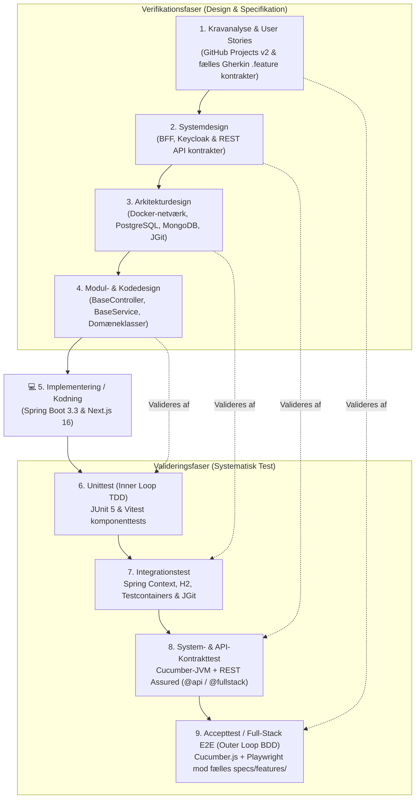

### 9.2 Automatiserede 98% Code Coverage Gates (6 JaCoCo + 4 Istanbul) & Meta-BDD Dogfooding
For at håndhæve systematisk testdækning på tværs af hele stakken stiller både backend og frontend + `sdlc/core` ufravigelige **98%-grænser** på samtlige officielle dækningsmetrikker, suppleret af fælles Meta-BDD dogfooding i [`generic_sdlc_framework.feature`](file:///z:/home/work/projects/api/specs/features/shared/generic_sdlc_framework.feature) (`@fullstack`, 3/3 scenarier bestået i både Cucumber-JVM og Cucumber.js):

- **Backend (`jacoco-maven-plugin` i [`backend/pom.xml`](file:///z:/home/work/projects/api/backend/pom.xml#L203-L246)):** Alle **6** officielle JaCoCo-tællere $\ge 0.98$ (seneste verifikation: **LINE 99,78%**, **BRANCH 98,39%**, **INSTRUCTION 99,75%**, **COMPLEXITY 98,32%**, **METHOD 99,79%**, **CLASS 100,00%**).
- **Frontend + SDLC 2-fils Kerne (`@vitest/coverage-istanbul` i [`frontend/vitest.config.ts`](file:///z:/home/work/projects/api/frontend/vitest.config.ts#L19-L35)):** Alle **4** officielle Istanbul-tællere $\ge 98\%$ uden `istanbul ignore`-undtagelser (seneste verifikation over **12 test-suites / 96 tests**: **Statements 99,49%**, **Branches 98,11%**, **Functions 99,21%**, **Lines 99,72%**).

```xml
<!-- Fra: backend/pom.xml (Linje 210-250) — samtlige 6 JaCoCo-tællere >= 0.98 -->
<rules>
  <rule>
    <element>BUNDLE</element>
    <limits>
      <limit><counter>LINE</counter><value>COVEREDRATIO</value><minimum>0.98</minimum></limit>
      <limit><counter>BRANCH</counter><value>COVEREDRATIO</value><minimum>0.98</minimum></limit>
      <limit><counter>INSTRUCTION</counter><value>COVEREDRATIO</value><minimum>0.98</minimum></limit>
      <limit><counter>COMPLEXITY</counter><value>COVEREDRATIO</value><minimum>0.98</minimum></limit>
      <limit><counter>METHOD</counter><value>COVEREDRATIO</value><minimum>0.98</minimum></limit>
      <limit><counter>CLASS</counter><value>COVEREDRATIO</value><minimum>0.98</minimum></limit>
    </limits>
  </rule>
</rules>
```

#### Dokumenterede Test Cases, Fundne Fejl og Rettelser (Jf. Slide 21)

| Test ID & Niveau | Testet funktion / Krav | Forventet resultat | Faktisk resultat (1. kørsel) | Fundet fejl / Misforståelse & Rettelse |
| :--- | :--- | :--- | :--- | :--- |
| **TC-01**<br>*Unittest & Integration*<br>(`GenericBaseArchitectureTest`) | Automatisk DTO $\leftrightarrow$ Entity konvertering og dynamisk `_like`/`_gte` filtrering i [`BaseService`](file:///z:/home/work/projects/api/backend/src/main/java/com/platform/core/service/BaseService.java). | `findAllDynamic()` filtrerer korrekt på UUID, tal og strenge og ignorerer `page`/`size`/`sort`-nøgler. | `ClassCastException` ved sammenligning af numeriske streng-filtre i JPA Criteria. | **Fejl:** Query-parametre ankom som `String`, men JPA `cb.greaterThan` krævede typet `Comparable`.<br>**Rettelse:** Implementerede `convertFilterValue(String val, Class<?> targetType)` i [`BaseService.java`](file:///z:/home/work/projects/api/backend/src/main/java/com/platform/core/service/BaseService.java#L279-L296). **Status: Bestået.** |
| **TC-02**<br>*Integrationstest*<br>(`AppointmentGitVersioningTest`) | Rollebaseret privatlivsfiltrering af JGit commit-historik mellem klient og terapeut. | Terapeuter må kun se delte journal-commits og kliniske noter – aldrig klientens rå booking-commits. | Terapeuter kunne i første iteration se commits med forfatteren `"Klinik Booking"`. | **Fejl:** `getCommitHistory()` returnerede alle commits på `<patientId>.md`.<br>**Rettelse:** Tilføjede striks rolle- og forfatterfiltrering i [`JournalGitService.java`](file:///z:/home/work/projects/api/backend/src/main/java/com/platform/service/JournalGitService.java#L147-L161) samt separat cache-nøgle `patientId + ":" + isTherapist`. **Status: Bestået.** |
| **TC-03**<br>*System / BFF Test*<br>(`keycloak_rbac_and_bff.feature`) | Kald gennem Next.js BFF Proxy, når Keycloak JWT udløber under en aktiv NextAuth-session. | Request gennemføres uden at logge brugeren ud, og rolle-opgradering synkroniseres ved CVR-onboarding. | Backend returnerede `HTTP 401 Unauthorized` ved udløbet Bearer token trods gyldig BFF-session. | **Fejl:** BFF sendte udløbet `Authorization`-header videre.<br>**Rettelse:** Implementerede fallback-retry med verificerede `X-Auth-*` session-headers i [`route.ts`](file:///z:/home/work/projects/api/frontend/src/app/api/backend/%5B...path%5D/route.ts#L96-L105). **Status: Bestået.** |
| **TC-04**<br>*Accepttest / E2E*<br>(`e2e_three_users_therapist_booking_payment.feature`) | Fuldt E2E-flow med 3 brugere: Klinik/Terapeut onboarding $\rightarrow$ Klient Handshake $\rightarrow$ Booking & Betaling. | Hele kæden gennemføres i Playwright og Cucumber uden mocks. | Bestået på tværs af alle 3 brugerroller (HTTP 200/201 og korrekt UI-opdatering). | Ingen fejl i slutevalueringen – bekræfter fuld sporbarhed mod kravspecifikationen. **Status: Bestået.** |
| **TC-05**<br>*Frontend Dual-App SoC, SDLC & 98% Gate*<br>(`baseCore.test.tsx`, `sdlc.test.ts` m.fl. + `generic_sdlc_framework.feature`) | Verifikation af Zero-Trust `AuthGateway`, `<RoleGuard />`, `DomainGuard`, `<ProblemAlert />`, Vertical Feature Slices samt 2-fils `sdlc/core`-motoren på tværs af alle 12 test-suites (96 tests) + 39 fælles `@fullstack` Cucumber.js-scenarier uden `istanbul ignore`-undtagelser. | Alle 96 tests og alle 4 Istanbul-metrikker (`lines`, `statements`, `functions`, `branches`) består $\ge 98\%$, og `generic_sdlc_framework.feature` består identisk i BE & FE. | **Bestået:** 12 test-suites (96 tests) bestået med **99,49% Statements, 98,11% Branches, 99,21% Functions og 99,72% Lines** i Vitest/Istanbul samt **39/39** Cucumber.js-scenarier. | Bekræfter vandtæt Separation of Concerns mellem `apps/landing` og `apps/dashboard` samt tredobbelt 2-fils symmetri på tværs af Backend, Frontend og SDLC-procesmotor. **Status: Bestået.** |

### 9.3 Delkonklusion
`[Opsummer hvordan testresultaterne dokumenterer kodens kvalitet og leder frem til produktevalueringen i Kapitel 10.]`

---

## 10. Evaluering og Konklusion på Produktdelen (Slide 22)

> [!NOTE]
> **Krav til Evaluering/konklusion på produktet (Slide 22):**
> - **Status på produktet:** Hvor står systemet ved aflevering?
> - **Opfyldelse af behov:** I hvilken grad indfries virksomhedens forretningsmæssige mål fra Kapitel 3?
> - **Opfyldelse af krav:** Gennemgang af funktionelle og non-funktionelle krav fra Kapitel 4.
> - **Fejl og uhensigtsmæssigheder:** Ærlig og kritisk refleksion over kendte begrænsninger og teknisk gæld.
> - **Videreudviklingsmuligheder:** Konkrete næste skridt for produktet (f.eks. distribueret Git/objekt-storage til JGit ved horisontal skalering, fuld produktionsudrulning af Fineract/KillBill betalingsgateways m.v.).

### 10.1 Status på opfyldelse af behov og krav
`[Udfyld samlet vurdering af målopfyldelsen ift. Kapitel 3 og Kapitel 4.]`

### 10.2 Kendte uhensigtsmæssigheder og teknisk gæld
- **Lokal fil-persistens i JGit (`./journal-repo`):** Da Eclipse JGit skriver til et lokalt filsystem/Docker-volume, kræver horisontal skalering til flere samtidige backend-replicas enten et delt netværksfilsystem (NFS/EFS) eller JGit's JDBC/DFS-backend.
- **Synkron BFF-rolleopgradering:** Synkroniseringen mod Keycloak Admin API i `route.ts` sker synkront ved CVR-onboarding og kan med fordel flyttes til en asynkron Kafka-event-consumer.

### 10.3 Perspektivering og videreudviklingsmuligheder
`[Beskriv forslag til fremtidig videreudvikling.]`

---

# DEL II: PROCESDEL (Slide 23–28)

> [!IMPORTANT]
> **Oversigt over Procesdelens 4 lovpligtige led (Slide 23):**
> 1. **Projektkarakteristika** (Slide 24 – herunder Boehm & Turners 5-aksede model)
> 2. **Valg af udviklingsmetode** (Slide 25 – sammenligning af alternativer, til-/fravalg af teknikker, fx *Scrum for One* eller *Gruppe-Scrum + XP*)
> 3. **Dokumentation af processen / tidsmæssigt overblik** (Slide 26 – Sprintplaner, backlog, prioriteringer, estimater, Gantt/Tidsplan)
> 4. **Refleksion over processen** (Slide 27–28 – Samlet retrospektiv på hvad der fungerede/ikke fungerede samt *Feedforward*).

---

## 11. Projektkarakteristika – Boehm & Turner Analyse (Slide 24)

> [!NOTE]
> **Krav til Projektkarakteristika (Slide 24 & Slide 29):**
> - Analyser hvad der kendetegner netop dette projekt, og hvordan det påvirker valget af udviklingsmetode.
> - Inddrag **Boehm & Turners 5 dimensioner** (vist på polar-diagrammet på Slide 24):
>   1. **Size (Størrelse):** Antal udviklere (1 studerende eller lille gruppe på 2–4 udviklere).
>   2. **Personnel (Udviklerkompetencer):** Erfaring med kendte vs. nye teknologier.
>   3. **Dynamism (Usikkerhed i krav):** Hvor ofte ændres/udvikles kravene pr. måned?
>   4. **Culture (Kultur):** Graden af autonomi/trivsel ved forandring vs. stram ordensstyring.
>   5. **Criticality (Kritikalitet):** Konsekvens ved fejl (fra *Comfort* over *Discretionary/Essential Funds* til *Single/Many Lives*).
> - Angiv desuden **Opgavetype** (*Nyudvikling*, *Videreudvikling*, *Innovation*) og **Tidshorisont**.

### 11.1 Analyse af projektets karakteristika (Fleksibel for 1 eller flere studerende)

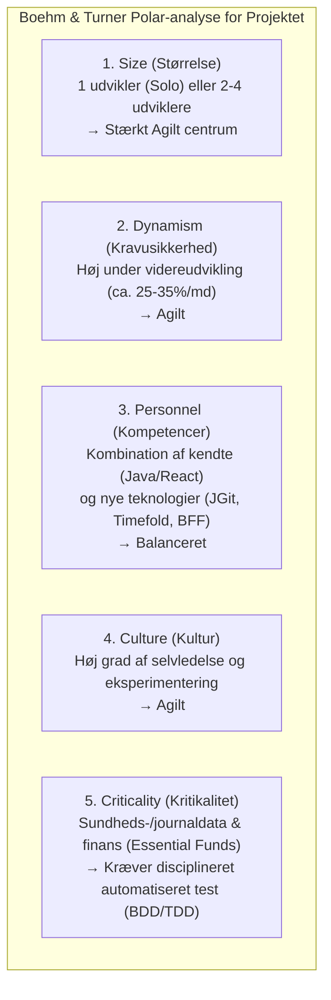

| Dimension (Boehm & Turner + Slide 24) | Vurdering for dette projekt *(Tilpas for 1 vs. flere studerende)* | Implikation for metodevalg |
| :--- | :--- | :--- |
| **1. Størrelse (Size)** | **[Ved 1 studerende]:** 1 udvikler (*Solo-udvikler*).<br>**[Ved gruppe]:** Lille team på 2–4 udviklere. | Minimalt kommunikationsoverhead; taler for en letvægts agil metode uden tungt mødebureaukrati. |
| **2. Udviklerkompetencer (Personnel)** | Solidt kendskab til Java, Spring Boot, SQL og TypeScript/React fra studiet og praktikken, kombineret med nye specialistteknologier (Eclipse JGit, Redisson L2, Timefold Solver, Next.js 16 BFF). | Kræver korte feedback-loops og spikes/prototyper ved introduktion af nye teknologier. |
| **3. Usikkerhed i krav (Dynamism)** | Middel til høj dynamik: Mens kerneforretningen fra praktikken lå fast, blev kravene til den generiske base-arkitektur og JGit-branch-filtrering løbende forfinet i hovedopgaveforløbet. | Taler for iterativ og inkrementel udvikling med korte sprints frem for en sekventiel vandfaldsmodel. |
| **4. Kultur (Culture)** | Høj grad af autonomi og fokus på eksekverbar kvalitet (Zero-Mock BDD/TDD). | Understøtter agilitet kombineret med teknisk disciplin fra Extreme Programming (XP). |
| **5. Kritikalitet (Criticality)** | Håndtering af personfølsomme sundheds-/journaldata og finansiel fakturering (*Discretionary / Essential Funds*). | Et rent uformelt agilt forløb er utilstrækkeligt; kritikaliteten kræver disciplinerede kvalitets-gates (Gherkin acceptkriterier, 98% JaCoCo gate, CI-pipelines). |
| **6. Opgavetype & Tidshorisont** | **Videreudvikling & arkitektonisk modning** af praktikprojekt over 3–4 uger (50% tid) parallelt med rapportskrivning frem mod 5. januar. | Kræver skarp prioritering i backloggen (Taiga), så hvert sprint leverer et færdigt, testet inkrement. |

### 11.2 Delkonklusion
`[Konkluder hvordan kombinationen af lille teamstørrelse/solo-arbejde (agilt) og høj datakritikalitet (disciplineret kvalitetssikring) fører til metodevalget i Kapitel 12.]`

---

## 12. Valg af udviklingsmetode og teknikker (Slide 25)

> [!NOTE]
> **Krav til Valg af udviklingstilgang (Slide 25 & Slide 29):**
> - **Alternative relevante metodetilgange:** Opstil relevante alternativer (f.eks. Plan-drevet/Vandfald vs. Klassisk Scrum vs. *Scrum for One* / Kanban kombineret med Extreme Programming (XP) BDD/TDD) og diskuter **fordele og ulemper** i forhold til projektets karakteristika fra Kapitel 11.
> - **Valg af metode:** Kvalificeret valg baseret på diskussionen.
> - **Valg og fravalg af teknikker:** Eksplicit gennemgang af, hvilke teknikker fra metoden der er **tilvalgt** og **fravalgt** – og hvorfor! *(Slide 25 fremhæver specifikt boksen **"Scrum for one"**, Scrum-loopet og XP-cirklen).*

### 12.1 Sammenligning af metodealternativer

| Metodetilgang | Fordele ift. projektet | Ulemper ift. projektet | Beslutning |
| :--- | :--- | :--- | :--- |
| **1. Plan-drevet (Vandfald / V-Model som proces)** | Tydelig dokumentation og faste faser fra start til slut. | Ufleksibel ved videreudvikling og teknisk udforskning (f.eks. JGit og generisk arkitektur) og giver sen feedback. | **Fravalgt som procesramme** *(V-modellen bruges dog som test-verifikationsmodel i Kapitel 9)*. |
| **2. Ren Kanban (Flow-baseret uden faste sprints)** | Lavt overhead, kontinuerligt flow på Kanban-boardet. | Mangler faste tidskasser (timeboxing) og strukturerede milepæls-evalueringer, hvilket øger risikoen for tidsnød op mod rapportafleveringen d. 5. januar. | **Delvist integreret** (Kanban-board i GitHub Projects v2 anvendes inden for faste sprints). |
| **3. Tilpasset Scrum (*"Scrum for One"* ved 1 studerende / *Letvægts-Scrum* ved gruppe) kombineret med XP (BDD/TDD) (Valgt)** | Forener fast kadence (1-uges sprints, Sprint Planning, Review/Vejledermøde og Retrospective) med XP's tekniske praksisser (Test-Driven Development, Continuous Integration, Refactoring). | Kræver høj selvdisciplin, særligt ved 1 studerende (*Scrum for One*), hvor udvikleren selv skal skifte kasket mellem udførende og reflekterende rolle. | **Valgt.** |

### 12.2 Til- og fravalg af konkrete teknikker fra Scrum og XP (Jf. Slide 25)

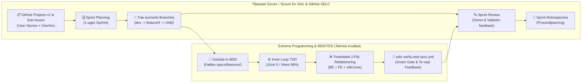

| Teknik / Ceremoni | Status (Tilvalgt / Tilpasset / Fravalgt) | Faglig begrundelse ift. projektet (1 vs. flere studerende) |
| :--- | :--- | :--- |
| **Product Backlog & User Stories (Scrum/XP)** | **Tilvalgt (Taiga $\rightarrow$ GitHub Projects v2)** | I Sprint 1–2 dokumenterede Taiga behovet for tættere kobling mod kodebasen; i det samlede monorepo samles alle krav som GitHub Issues og hierarkiske Sub-Issues med eksekverbare Gherkin-kontrakter i `specs/features/`, styret af [`sdlc.config.json`](file:///z:/home/work/projects/api/sdlc.config.json) samt [`.github/workflows/sdlc-issue-sync.yml`](file:///z:/home/work/projects/api/.github/workflows/sdlc-issue-sync.yml) og [`sdlc-verify-and-sync.yml`](file:///z:/home/work/projects/api/.github/workflows/sdlc-verify-and-sync.yml). |
| **Sprint-længde (Timeboxing)** | **Tilpasset (1-uges sprints)** | Da videreudviklingen i hovedopgaveforløbet strækker sig over 3–4 uger (50% tid), ville klassiske 2–4 ugers sprints give for få iterationer. 1-uges sprints sikrer hyppig re-prioritering. |
| **Daily Scrum** | **Fravalgt (ved 1 stud.) / Tilpasset (ved gruppe)** | **Ved 1 studerende (*Scrum for One*):** Et dagligt møde med sig selv giver ingen værdi; erstattet af automatiseret GitHub Projects v2 statusopdatering.<br>**Ved gruppe:** Korte asynkrone/synkrone check-ins på arbejdsdage. |
| **Planning Poker (Estimering)** | **Fravalgt (ved 1 stud.) / Tilvalgt (ved gruppe)** | **Ved 1 studerende:** Konsensus-poker giver ikke mening alene; erstattet af T-shirt/Story Point estimering baseret på historisk velocity.<br>**Ved gruppe:** Anvendt til at afdække forskelle i teknisk forståelse. |
| **Test-Driven Development (TDD) & BDD (XP)** | **Tilvalgt (Kernepraksis)** | Sikrer at al ny funktionalitet først defineres som fejlende Cucumber/JUnit/Vitest-test før implementering, håndhævet af 98% coverage gates på alle 6 JaCoCo- og alle 4 Istanbul-tællere. |
| **Pair Programming (XP)** | **Fravalgt (ved 1 stud.) / Selektivt (ved gruppe)** | Ved individuel hovedopgave erstattet af AI-assisteret parprogrammering (sparring og code review med AI-agent) samt automatiserede CI-tjek (`sdlc:verify`). |

### 12.3 Delkonklusion
`[Opsummer hvordan den skræddersyede kombination af Scrum/Scrum for One og XP passer præcist til projektets rammer.]`

---

## 13. Dokumentation af processen – Tidsmæssigt overblik (Slide 26)

> [!NOTE]
> **Krav til Dokumentation af proces & tidsforløb (Slide 26 & Slide 29):**
> - Vis et konkret overblik over projektets tidsforløb med:
>   - **Sprintplaner / Projektplan** (f.eks. Gantt-kort / tidslinje og Sprint-oversigt)
>   - **Prioriteringer** (f.eks. MoSCoW eller forretningsværdi vs. teknisk risiko)
>   - **Estimater vs. faktisk tidsforbrug** (f.eks. planlagte vs. realiserede Story Points pr. sprint)
> - Indsæt gerne screenshots/diagrammer af jeres backlog-board (f.eks. Taiga) og sprintforløb.

### 13.1 Projekt- og Sprintplan rekonstrueret fra Git Commits (Gitgraph & Sprint-log)

> [!TIP]
> **Procesmæssig transparens (Git Commits som empirisk dokumentation):**  
> Da opgavesporingen i Taiga ikke blev opdateret konsekvent ved hver enkelt delopgave, er det faktiske tidsforløb rekonstrueret empirisk ud fra projektets Git-historik (`git log` på tværs af `api`, `backend` og `frontend` fra første commit d. **7. september 2026**). Dette giver et nøjagtigt, tidsstemplet revisionsspor over alle udviklingsfaser.

#### Branch- og Merge-historik (`gitGraph`)

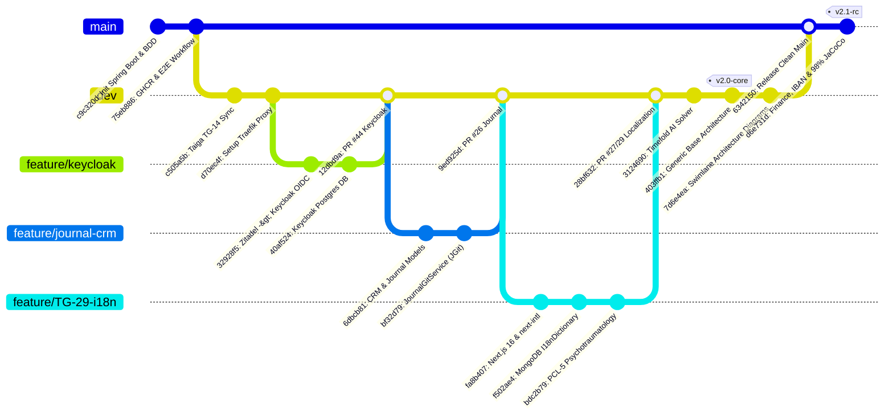

### 13.2 Sprintoversigt med faktiske Git Commits, prioriteringer og estimater

| Sprint & Periode | Centrale Git Commits (`backend` / `frontend` / `api`) | Leverancer & Prioritet (MoSCoW) | Estimeret vs. Faktisk | Afvigelse & Forklaring |
| :--- | :--- | :--- | :---: | :--- |
| **Sprint 1**<br>*(07/09 – 14/09)* | `c9c320d`, `ca5872f`, `f33d296`, `75eb886`, `89bcf24` | **Must Have:** Spring Boot + JPA init, Gherkin `.feature`-filer, Dockerfiles, GHCR CI/CD og Playwright E2E-skelet. | 13 SP / 13 SP | `0 SP`: Planmæssig etablering af repository- og CI-fundament. |
| **Sprint 2**<br>*(14/09 – 25/09)* | `46c4615`, `c505a5b` (`TG-14`), `d70ec4f`, `32928f5`, `40af524`, `069386f`, `33df4da` | **Must Have:** Traefik reverse proxy, migrering fra Zitadel til **Keycloak OIDC** (`feature/keycloak`) samt Taiga BDD webhook. | 13 SP / 16 SP | `+3 SP`: Skiftet fra Zitadel til Keycloak krævede ny PostgreSQL `auth-db` og OAuth2 JWKS-konfiguration. |
| **Sprint 3**<br>*(26/09 – 02/10)* | `91c9794`, `a17c344` (`TG-26`), `6446311` (`TG-27`), `fa8b407`, `94e7ed1`, `bf32d79`, `f502ae4`, `21432bf` | **Must Have:** Skift fra Vite til **Next.js 16 BFF + NextAuth**, [`JournalGitService`](file:///z:/home/work/projects/api/backend/src/main/java/com/platform/service/JournalGitService.java) (Eclipse JGit), `I18nService` (MongoDB) & Docker secrets. | 15 SP / 17 SP | `+2 SP`: Indførelse af Next.js BFF-proxy og Docker secrets på tværs af containere. |
| **Sprint 4**<br>*(03/10 – 12/10)* | `3103cd9`, `1d0e7e9`, `bdc2b79`, `efc4357`, `5f22640`, `d118282`, `aa45c1c` (`TG-29`), `28bf632` | **Must Have:** UUID-identitet, `ProviderProfile`, `Service`, `Psychotraumatology` (PCL-5), `TherapistClinicalNote` & `feature/TG-29-i18-localization`. | 13 SP / 13 SP | `0 SP`: Høj kadence pga. genbrug af etableret BFF- og MongoDB/JPA-struktur. |
| **Sprint 5**<br>*(13/10 – 25/10)* | `44238d6`, `6b6d01b`, `2da49bb`, `3124690`, `5c87524`, `403ffb1`, `7d6e4ea`, `d6e731d`, `9668e6a` | **Must / Should Have:** **Generisk Base-Arkitektur** (`403ffb1`), **Timefold Solver** (`3124690`), Multi-Window JGit UI (`6b6d01b`), Finans/IBAN & **98% JaCoCo gate** (`d6e731d`). | 18 SP / 20 SP | `+2 SP`: Opnåelse af $\ge 98\%$ line & branch coverage på tværs af alle services. |
| **Hovedopgave**<br>*(27/10 – 05/01)* | Rapportskrivning, Skriveworkshop (24/11), Vejledermøder & Aflevering (05/01) | **Must Have:** Dokumentation af Produktdel (Kap. 1–10) og Procesdel (Kap. 11–14). | `[Udfyld]` | `[Udfyld ved afslutning]` |

### 13.3 Automatiseret sporbarhed mellem Krav (GitHub Projects v2), Træ-isomorfe Branches, Kontrakter og Test
Hvor Sprint 1–2 benyttede Taiga og en ekstern webhook-synkronisering (`taiga_bdd_sync.yml`), valgte jeg i hovedopgaven at bruge **GitHub Projects** sammen med **GitHub Issues** for at skabe et direkte, integreret samarbejde mellem kodebasen og hele **Software Development Life Cycle (SDLC)** uden tilstandsdrift mod eksterne værktøjer. Projektets **Generiske GitHub SDLC-Framework** ([`sdlc.config.json`](file:///z:/home/work/projects/api/sdlc.config.json), [`sdlc-domain.ts`](file:///z:/home/work/projects/api/sdlc/core/sdlc-domain.ts) og [`sdlc-github.ts`](file:///z:/home/work/projects/api/sdlc/core/sdlc-github.ts)) konsoliderer hele livscyklussen gennem tre sammenhængende workflows: [`.github/workflows/sdlc-issue-sync.yml`](file:///z:/home/work/projects/api/.github/workflows/sdlc-issue-sync.yml) (som oversætter GitHub Issues & hierarkiske Sub-Issues til træ-isomorfe branches `dev` $\rightarrow$ `feature/<id>-<slug>` $\rightarrow$ child-branches og delte Gherkin-kontrakter i `specs/features/`), [`.github/workflows/sdlc-commit-sync.yml`](file:///z:/home/work/projects/api/.github/workflows/sdlc-commit-sync.yml) (som på tværs af `api`, `backend` og `frontend` synkroniserer commit-tags som `#backlog`, `#spec-ready`/`#spec`, `#red-outer-bdd`/`#bdd`/`#red`, `#inner-tdd`/`#tdd`, `#green-gate`/`#green` og `#regression` direkte med GitHub Issues og board-status), samt [`.github/workflows/sdlc-verify-and-sync.yml`](file:///z:/home/work/projects/api/.github/workflows/sdlc-verify-and-sync.yml), der via `sdlc:verify` (6 JaCoCo- og 4 Istanbul-gates på 100%) eksklusivt styrer `Done`-overgangen ved grøn CI / merge til `main` og lukker det to-vejs *Living Spec & Regression feedback-loop*.

### 13.4 Delkonklusion
`[Opsummer hvad tidsforløbet og estimaterne viser om projektets fremdrift, som evalueres i Kapitel 14.]`

---

## 14. Refleksion over processen – Retrospektiv & Feedforward (Slide 27–28)

> [!NOTE]
> **Krav til Refleksion over processen I & II (Slide 27 & Slide 28):**
> - **Samlet afsluttende retrospective:** Beskriv hvordan processen har fungeret, hvad der **fungerede / ikke fungerede**, **hvorfor**, samt **hvad du/I gjorde for at ændre det** undervejs.
> - **Tag udgangspunkt i en eller flere af vinklerne fra Slide 27:**
>   - *a) Anvendte procesteknikker:* F.eks. brugen af repository/branch-strategi, Outside-In BDD/TDD-test, GitHub Projects v2 & SDLC-integration, bruger-/vejlederinddragelse.
>   - *b) Iterationer/sprints som basis:* Hvordan I har planlagt, evalueret og tilpasset metoden gennem projektet.
>   - *c) Systematisk evaluering af metodevalg:* Fordele og ulemper ved de valgte metodedele.
> - **Opsummering af processen som helhed & Feedforward (Slide 28):** Hvad er den vigtigste proceslæring, og **hvad ville du/I gøre anderledes en anden gang?**

### 14.1 Retrospektiv på anvendte procesteknikker og iterationer (Slide 27)

| Procesteknik / Område | Hvad fungerede godt – og hvorfor? | Hvad fungerede mindre godt – og hvilken tilpasning blev foretaget? |
| :--- | :--- | :--- |
| **Outside-In BDD/TDD & 98% Coverage Gates** | Sikrede at refaktoreringen til `BaseController`/`BaseService` og 2-fils frontend-kernen kunne gennemføres uden regressioner. Fælles Gherkin-scenarier i `specs/features/` fungerede som levende dokumentation for både backend og frontend. | Den høje grænse på 98% på samtlige 6 JaCoCo- og 4 Istanbul-tællere kunne i starten bremse hurtige arkitektur-eksperimenter (spikes). **Tilpasning:** Spikes blev afprøvet på isolerede branches, før løsningen blev skrevet TDD-baseret og håndhævet af `sdlc:verify`. |
| **Parallelt udviklings- og skriveforløb (50%/50%)** | At skrive udkast til Kapitel 5 (Teknologi) og Kapitel 6 (Arkitektur) sideløbende med Sprint 1–2 skærpede argumentationen for de valgte designmønstre. | Risiko for kontekstskift mellem dyb kodning og akademisk rapportskrivning. **Tilpasning:** Faste ugedage blev opdelt i dedikerede "udviklingsdage" og "rapportdage" frem mod vejledermøderne. |
| **Fra Taiga-synk (Sprint 1–2) til Generisk GitHub SDLC-Framework** | Ekstern backlog-synkronisering mod Taiga afslørede i Sprint 1–2 værdien af formelle `.feature`-kontrakter og fast branch-navngivning (`feature/<id>-<navn>`). | To-systemsarkitekturen mellem ekstern Taiga-server og GitHub skabte webhook- og tilstandsdrift (*state drift*). **Tilpasning:** Processen blev konsolideret i det 100% GitHub-native **Generiske GitHub SDLC-Framework** (`sdlc/core/sdlc-domain.ts` + `sdlc-github.ts` + `sdlc.config.json`), der styrer Projects v2 via `gh` CLI og lukker feedback-loopet direkte i CI. |

### 14.2 Samlet proceskonklusion og Feedforward (Slide 28)
`[Beskriv her det samlede retrospektiv på forløbet og "Feedforward": Hvad ville du/I gøre anderledes i et fremtidigt projekt? F.eks. tidligere fastlæggelse af den generiske base-arkitektur allerede i Sprint 0, automatiseret generering af arkitekturdiagrammer i CI-pipelinen, og endnu skarpere afgrænsning af scope på små features.]`

---

# DEL III: GENERELLE KRAV, TOMMELFINGERREGLER & KILDEBRUG (Slide 29–33)

---

## 15. Tjekliste til alle afsnit, layout og AI/kildehenvisning

> [!TIP]
> **Kvalitetstjekliste før aflevering til vejleder og i WISEflow d. 5. januar (Slide 29, 30 & 31):**
> Gennemgå hvert eneste kapitel i rapporten ud fra nedenstående krav fra præsentationen:

### 15.1 Generelle krav til ALLE hovedafsnit (Slide 29)
- [ ] **Sigende rapporttitel:** Titlen beskriver konkret, hvad der er udviklet, og med hvilke teknologier (f.eks. *"Udvikling af [X] med [Y]-teknologi og [Z]-teknologi"*), da titlen kommer til at stå på **eksamensbeviset**.
- [ ] **Indledning til hvert kapitel:** Hvert kapitel starter med en kort indledning, der præsenterer afsnittets **formål**, **læsevejledning/målgruppe** og **struktur**.
- [ ] **Delkonklusion i hvert kapitel:** Hvert kapitel afsluttes med en **delkonklusion**, der opsummerer kapitlets vigtigste resultater og diskussioner og skaber overgang til næste kapitel.

### 15.2 Tommelfingerregler for formidling og layout (Slide 30)
- [ ] **Mange figurer, diagrammer og illustrationer:** Understøt tekst med UML-diagrammer, arkitekturskitser og tabeller.
- [ ] **Mange konkrete eksempler:** Brug reelle eksempler (User Stories, kodeudsnit, test cases) fra projektet.
- [ ] **Ensartet layout (standard):**
  - Nummerering af alle afsnit (1, 1.1, 1.2 osv.).
  - Nummerering og kildeangivelse på **alle** figurer, tabeller og bilag (f.eks. *Figur 6.1: Deployment-arkitektur (Egen tilvirkning)*).
  - Header og footer med sidetal på alle sider.
- [ ] **Korrekte krydshenvisninger:** Henvis præcist til figur-, bilags- og afsnitsnumre i brødteksten.
- [ ] **Rød tråd & Ingen fremadhenvisninger:** Afsnittene skal følge en logisk rækkefølge, og man skal **undgå fremadhenvisninger** (introducer ikke begreber, der først forklares tre kapitler senere).
- [ ] **Korrekturlæsning:** Lad flere forskellige personer læse korrektur før aflevering d. 5. januar.

### 15.3 Regler for kildebrug, citater og AI (Slide 31)

> [!CAUTION]
> **Advarsel mod plagiat og udeklareret AI-tekst (Slide 31):**  
> **Afskrift/kopiering er strengt forbudt og betragtes som eksamenssnyd!**  
> Hvis du identisk eller næsten identisk gengiver andres formuleringer eller værker som dine egne ved at undlade kildeangivelse med anførselstegn (`"..."`), kursivering, indrykning eller anden tydelig markering, betragtes det som eksamenssnyd. **Dette gælder også anvendelse af tekster genereret af AI (f.eks. chatbots og lignende).**

- **Krav til referencer:**
  - Alle anvendte kilder (bøger, artikler, officiel dokumentation, hjemmesider) og lånte figurer skal have tydelig kildehenvisning i teksten og specificeres i litteraturlisten.
  - Direkte citater skal altid stå i anførselstegn `"..."` med nøjagtig kilde- og sidehenvisning.
- **Officielle EK-links fra Slide 10, 20 & 31:**
  - [Studieordning for datamatiker (2024)](https://www.ek.dk/media/5y3ohqiy/dat_cba_studieordning_2024.pdf)
  - [Implementation – Eksempel fra Moodle (SharePoint PDF)](https://erhvervsakademikbenhavn.sharepoint.com/:b:/s/cph-Lyngby/IQDOSQJqzyrqT68VdUbBqx2dAexS5E_IEwOseCfMsbS5ymU?e=KsKqWp)
  - [Eksamensregler: Brug af AI (herunder ChatGPT eller lign.)](https://mit.ek.dk/studiehaandbog/eksamensregler#under-strongeksamenstrong-brug-af-ai-herunder-chatgpt-eller-lign-item)
  - [Studieviden: Referencer ved brug af AI](https://mit.ek.dk/studieviden/referencer#ai)
  - [Studieviden: Rammer og retningslinjer for brug af GenAI](https://mit.ek.dk/studieviden/generativ-ai#retningslinjer)

---

## 16. Litteraturliste (Skabelon)

- **Boehm, B. & Turner, R. (2003):** *Balancing Agility and Discipline: A Guide for the Perplexed*. Addison-Wesley Professional.
- **Eclipse Foundation (2024):** *Eclipse JGit Documentation (v6.10.0)*. Tilgængelig på: `https://www.eclipse.org/jgit/`
- **Erhvervsakademi København (2024):** *Studieordning for erhvervsakademiuddannelsen inden for informationsteknologi (Datamatiker AK)*. Tilgængelig på: `https://www.ek.dk/media/5y3ohqiy/dat_cba_studieordning_2024.pdf`
- **Fowler, M. (2002):** *Patterns of Enterprise Application Architecture*. Addison-Wesley.
- **Newman, S. (2021):** *Building Microservices: Designing Fine-Grained Systems* (2nd ed., kapitel om Backend-For-Frontend / BFF). O'Reilly Media.
- **Schwaber, K. & Sutherland, J. (2020):** *The Scrum Guide*. Tilgængelig på: `https://scrumguides.org/`
- **Spring Framework Documentation (2024):** *Spring Boot 3.3 & Spring Security OAuth2 Resource Server Reference*. Tilgængelig på: `https://docs.spring.io/spring-boot/index.html`

---

## 17. Bilagsoversigt (Skabelon)

- **Bilag 1:** Fuldt EER-diagram og databaseskema ([`infrastructure/diagrams/eer-diagram.puml`](file:///z:/home/work/projects/api/infrastructure/diagrams/eer-diagram.puml))
- **Bilag 2:** Komplet Backend & Frontend Klassediagram ([`infrastructure/diagrams/class-diagram-backend.puml`](file:///z:/home/work/projects/api/infrastructure/diagrams/class-diagram-backend.puml), [`infrastructure/diagrams/class-diagram-frontend.puml`](file:///z:/home/work/projects/api/infrastructure/diagrams/class-diagram-frontend.puml))
- **Bilag 3:** Swimlane-arkitekturdiagrammer pr. domæne (`appointment`, `clinic-platform`, `core`, `i18n`, `journal`, `psychotraumatology`, `user`)
- **Bilag 4:** Komplet Cucumber BDD & JaCoCo Testrapport (`98%` Coverage verifikation)
- **Bilag 5:** Sprint-log og Taiga Backlog-udtræk
