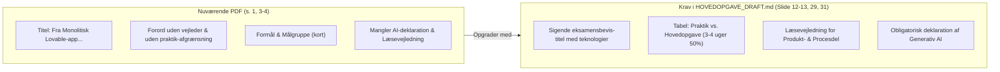

# Vurdering og Gap-Analyse af Hovedopgave (PDF vs. `HOVEDOPGAVE_DRAFT.md`)

> [!IMPORTANT]
> **Overordnet Dom & Karaktervurdering**
> - **Teknisk niveau i projektet (Produkt & Testsetup):** **10 – 12 (Fremragende)**  
>   De nyeste afsnit i din PDF (s. 7–10, s. 12–14 og s. 16–17) samt kodebasen dokumenterer et imponerende 5.-semesters projekt med Spring Boot 3.3, generisk base-arkitektur (`BaseEntity` $\rightarrow$ `BaseController`), Next.js 16 BFF, Keycloak OIDC, Polyglot Persistence (PostgreSQL, MongoDB, Redis, Kafka), Eclipse JGit revisionslogning, Timefold Solver og en Outside-In BDD/TDD-teststrategi med 98% coverage gate.
> - **Rapportens nuværende tilstand (PDF på 22 sider):** **Ikke afleveringsklar (00 / 02 i nuværende form)**  
>   PDF'en fremstår lige nu som en halvfærdig sammensmeltning af en ældre praktikrapport og nye hovedopgaveafsnit. Den indeholder **efterladte kladdenoter til dig selv**, **alvorlige tekniske selvmodsigelser**, **brud på din egen NDA-anonymisering**, **0 linjer kildekode**, **kun 1 diagram i hele rapporten** og **ingen litteraturliste**. Desuden er rapporten på ca. **11–12 normalsider** (ca. 27.000 tegn) mod kravet på **22,5–30 normalsider** (54.000–72.000 tegn).
> - **Potentiale ved opretning efter [`HOVEDOPGAVE_DRAFT.md`](file:///z:/home/work/projects/api/HOVEDOPGAVE_DRAFT.md):** **10 eller 12**  
>   Fordi du allerede har alle diagrammer, kodeeksempler, tabeller og analyser liggende klar i [`HOVEDOPGAVE_DRAFT.md`](file:///z:/home/work/projects/api/HOVEDOPGAVE_DRAFT.md) og [`HOVEDOPGAVE_DIAGRAMMER.md`](file:///z:/home/work/projects/api/HOVEDOPGAVE_DIAGRAMMER.md), kan rapporten løftes til en topkarakter ved systematisk at udskifte kladdeafsnittene og indsætte de manglende elementer.

---

## 1. Kritiske Selvmodsigelser og NDA-brud (Skal rettes først!)

Hvis en censor læser PDF'en fra side 1 til 22, vil vedkommende støde på **7 direkte selvmodsigelser**, hvor rapporten modarbejder sig selv:

| # | Område | Hvad der står ét sted i PDF'en | Hvad der står et andet sted i PDF'en | Konsekvens & Løsning |
| :-: | :--- | :--- | :--- | :--- |
| **1** | **NDA & Anonymitet** | **Side 1 & Side 3:** *"Jeg har underskrevet en NDA og virksomheden gerne vil være anonym... har anonymiseret alle data i mit produkt og i min rapport."* | **Side 14:** *"Skiftet var en massiv succes for **IFHI**"* **Side 20 (3 gange):** *"...et nyt fundament for **Institut for Human Intelligences** softwareudvikling..."* **Side 8:** Eksponerer live IP `157.180.43.151`. | **Kritisk NDA-brud!** Erstat alle forekomster af *"IFHI"* og *"Institut for Human Intelligence"* på s. 14 og 20 med *"virksomheden"* eller *"case-virksomheden"*, og maskér evt. IP'en som `<SERVER-IP>.nip.io` (eller gør opmærksom på, at det er en isoleret studie-VPS uden virksomhedsdata). |
| **2** | **Backend Tech Stack** | **Side 1 & Side 12:** Backend er skrevet i **Java (Spring Boot, Maven `pom.xml`, JUnit 5, Eclipse JGit, Timefold)**. | **Side 11 (Afsnit 2.4):** *"Backend-endpoints blev isoleret i et **Node.js/Express-lignende miljø**, mens React-komponenterne fik deres eget hjem."* | Censor vil tro, at teksten på s. 11 er kopieret fra et andet projekt. Slet s. 11's omtale af Node.js/Express og beskriv i stedet **Spring Boot 3.3 (Java 17)** og **Next.js 16 (App Router + BFF)**. |
| **3** | **IAM / Auth-server** | **Side 8, 9 & 13:** Platformen bruger **Keycloak (v24.0.4)** med dedikeret PostgreSQL (`auth-db`) og `OAuth2-Proxy`. | **Side 14 (Afsnit 2.7):** *"...dokumentationen for Playwright, **ZITADEL** og TypeScript."* **Side 20 (Konklusion):** *"...implementeringen af **ZITADEL**, som anvender sin egen private autentificeringsdatabase..."* | ZITADEL blev udskiftet med **Keycloak** i Sprint 2. I Produktdelen og Konklusionen (s. 14 og 20) **skal** der stå **Keycloak**. ZITADEL må kun nævnes i Kapitel 5 (som fravalgt alternativ) eller i Procesdelen (som en tidlig erfaring). |
| **4** | **Code Coverage Krav** | **Side 6 (NFR #2):** *"...minimum testdækning (code coverage) på **f.eks. 70%** af forretningslogikken, målt automatisk via Jacoco..."* | **Side 14 (Afsnit 2.6):** *"...håndhæves en striks tærskelværdi (coverage gate) på **minimum 98 % dækning** på tværs af samtlige måleparametre..."* | Ret NFR #2 på side 6 fra *"f.eks. 70%"* til det konkrete, målbare krav på **minimum 98% dækning** på linjer, forgreninger, instruktioner, metoder, klasser og kompleksitet. |
| **5** | **CI/CD & Infra-repo** | **Side 3, 6, 7–8 & 16–17:** Systemet er delt i **3 repositories** (`infrastructure`, `frontend`, `backend`) med **100% automatiseret CI/CD i GitHub Actions**, som afvikler alle unit- og BDD-tests samt coverage gates ved hvert build. | **Side 18–19 (Afsnit 3.3):** *"Derefter valgte jeg, at **slette infrastructure repository'et fra GitHub**... Jeg indså også, at **en CI pipeline var udenfor projektets scope**."* | Direkte selvmodsigelse mellem Produktdel og Procesdel! Omformuler s. 18–19, så det fremgår, at du *forfinede* CI/CD-pipelinen fra tunge Git-submodules til en strømlinet multi-stage Docker Buildx + BDD-sync pipeline, frem for at sige at CI var "udenfor scope". |
| **6** | **Microservices vs. Modulær Monolit & MVC** | **Side 1 & 6:** Kalder løsningen en *"microservice arkitektur"*. **Side 10:** Kalder `infrastructure` for *Model*, `frontend` for *View* og `backend` for *Controller* (MVC). | **Side 7–10 & Kodebasen:** Én samlet Spring Boot kerne-backend (`backend`) og én Next.js 16 BFF/frontend (`frontend`) omgivet af Docker-infrastruktur. | **Farlig teoretisk fejl til eksamen!** 1) At adskille frontend og backend gør det *ikke* til microservices – kald det en **Containeriseret Modulær Monolit med Next.js BFF og Polyglot Persistence** (jf. [`HOVEDOPGAVE_DRAFT.md`](file:///z:/home/work/projects/api/HOVEDOPGAVE_DRAFT.md#L448-L453)). 2) Infrastruktur er **ikke** "Model" i MVC. Beskriv i stedet den **lagdelte arkitektur** i backenden (`BaseController` $\rightarrow$ `BaseService` $\rightarrow$ `BaseRepository` $\rightarrow$ `BaseEntity`). |
| **7** | **Krav & User Stories vs. Teknologier** | **Side 6 & Bilag 5.1 (s. 21–22):** Nævner kun 4 helt basale krav (opret klient, opret terapeut, opret service, book aftale). | **Side 9–10 & 12–13:** Beskriver pludselig **Eclipse JGit journal-commits**, **PCL-5 traumetests**, **MongoDB i18n-ordbøger**, **Timefold Solver** og **Kill Bill / Fineract**. | Den røde tråd knækker, når avancerede moduler dukker op i teknologi- og testafsnittet uden at være nævnt i Behovsanalyse eller Kravspecifikation. Opdater Krav (Afsnit 2.1) med scope og krav fra [Kapitel 3 og 4 i `HOVEDOPGAVE_DRAFT.md`](file:///z:/home/work/projects/api/HOVEDOPGAVE_DRAFT.md#L207-L405). |

---

## 2. Efterladte Kladdenoter ("To-Do"-tekst) i PDF'en

Følgende tekststykker i PDF'en er interne huskenoter, som ved en fejl står direkte i rapportteksten:

1. **Side 6 (Afsnit 2.1 Krav):**  
   > *"Hvad er inde for scope og hvad er udenfor scope. præsenter funktionelle krav en god idé kan være user stories med acceptence kriterier og non-funktionelle krav."*
2. **Side 10 (Afsnit 2.3 Arktitektur):**  
   > *"Jeg har valgt at bruge disse 2 design patterns, men jeg har tænkt mig, at finde ud af om de er den samme type design pattern før jeg aflevere opgaven Repository Pattern sammen med Factory Pattern"*  
   > *"Skriv noget om, at projecktet er bygget op efter Model (infrastructure), View (frontend), Controller (backend)."*
3. **Side 10 (Afsnit 2.4 Design):**  
   > *"Skriv noget om, at projecktet er bygget op efter Model (infrastructure), View (frontend), Controller (backend)."*
4. **Side 14 (Afsnit 2.7 Evaluering af Produktet):**  
   > *"På dette niveau skal jeg vurdere produktets samlede værdi."*
5. **Side 15 (Afsnit 3.1 Projektkarakteristika):**  
   > *"(Click på denne tekst for at se mit Kanban board)"* *(Tekst uden link og uden screenshot).*
6. **Side 22 (Bilag 5.1.5, 5.1.6, 5.1.7 & 5.2):**  
   > `5.1.5 View appointment` mangler Acceptance Criteria, og `5.1.6 Update appointment (as client)`, `5.1.7 Cancel appointment (as client)` og `5.2 Diagrammer` er helt tomme overskrifter uden indhold.

---

## 3. Skarp Skillelinje: Praktikforløb vs. Hovedopgaveforløb (Jf. Slide 4 & 12)

Ifølge Erhvervsakademi Københavns retningslinjer i [`HOVEDOPGAVE_DRAFT.md`](file:///z:/home/work/projects/api/HOVEDOPGAVE_DRAFT.md#L78-L84) (Slide 4 & Slide 12) **skal** Forordet præcist afgrænse, hvad der blev lavet under dit 11-ugers praktikforløb, og hvad der er videreudviklet i hovedopgaveperioden (3–4 uger på 50% tid). I din nuværende PDF nævnes dette **slet ikke**.

Her er den anbefalede, anonymiserede afgrænsning (tilpasset fra [`HOVEDOPGAVE_DRAFT.md`](file:///z:/home/work/projects/api/HOVEDOPGAVE_DRAFT.md#L153-L160)), som du kan sætte direkte ind i **Forordet**:

| Periode | Fokus & Leverancer (100% Anonymiseret Case) |
| :--- | :--- |
| **Praktikforløb (11 uger)** *(August – Oktober 2026)* | • Analyse af case-virksomhedens oprindelige Lovable-genererede TypeScript-monolit. • Etablering af containeriseret infrastruktur med Docker Compose, Traefik v3.1 reverse proxy, Keycloak OIDC, PostgreSQL, MongoDB, Redis og Apache Kafka. • Dekobling af grundlæggende klient-, terapeut-, organisations- (CVR) og booking-entiteter samt Next.js 16 BFF-proxy og `next-intl` flersproget understøttelse. |
| **Hovedopgaveforløb (Videreudvikling: 3–4 uger á 50% tid)** *(Oktober – December 2026)* | • **Generisk Base-Arkitektur (Kodedesign & Refactoring):** Design og implementering af parametriserede baseklasser ([`BaseEntity`](file:///z:/home/work/projects/api/backend/src/main/java/com/platform/core/entity/BaseEntity.java), [`BaseRepository`](file:///z:/home/work/projects/api/backend/src/main/java/com/platform/core/repository/BaseRepository.java), [`BaseService`](file:///z:/home/work/projects/api/backend/src/main/java/com/platform/core/service/BaseService.java), [`BaseController`](file:///z:/home/work/projects/api/backend/src/main/java/com/platform/core/controller/BaseController.java)) med Spring `GenericTypeResolver`, dynamisk JPA `Specification`-filtrering og `CrudInterceptor` lifecycle-hooks. • **Uforanderlig Revisionslogning (Eclipse JGit):** Udvidelse af [`JournalGitService`](file:///z:/home/work/projects/api/backend/src/main/java/com/platform/service/JournalGitService.java) med SHA-1 commit-historik, branch-isolering og rollebaseret privatlivsfiltrering mellem klient og terapeut. • **Skemaoptimering & Finansintegration:** Deterministisk kollisions- og arbejdstidsvalidering med Timefold Solver samt integration af fakturerings- og hovedbogsmotorer (Kill Bill & Apache Fineract). • **Kvalitetssikring (Outside-In BDD/TDD):** Udbygning af JUnit 5, Cucumber, REST Assured, Vitest og Playwright testsuiterne til en **98% Coverage Gate** i JaCoCo og Istanbul. |

---

## 4. Afsnit-for-Afsnit Vurdering mod `HOVEDOPGAVE_DRAFT.md`

Nedenfor gennemgås hvert eneste afsnit i din PDF op imod de officielle krav fra Erhvervsakademi København i [`HOVEDOPGAVE_DRAFT.md`](file:///z:/home/work/projects/api/HOVEDOPGAVE_DRAFT.md).

### 4.1 Titel, Resumé, Forord & Introduktion (PDF s. 1 & s. 3–4 $\leftrightarrow$ Draft Kap. 1–2)

- **Hvad fungerer:** Fin motivation for, hvorfor en tætkoblet AI-genereret Lovable-kodebase skaber merge-konflikter og lav fejlsporbarhed.
- **Hvad mangler / skal rettes:**
  1. **Eksamensbevis-titel (Slide 29):** Titlen skal afspejle *hvad* der er udviklet og *med hvilke teknologier* (fx: *"Fra Monolitisk Lovable-app til Containeriseret Platform: Udvikling af et Klinisk Booking- og Journaliseringssystem med Spring Boot 3, Next.js 16 BFF, Keycloak OIDC og Eclipse JGit"*).
  2. **Forord (Slide 4 & 12):** Mangler navn på vejleder samt den lovpligtige adskillelse mellem praktik og hovedopgave (brug tabellen i Afsnit 3 ovenfor).
  3. **Forkert beskrivelse af Git i en monolit (s. 3):** På s. 3 skriver du: *"Hvis man ikke pull'er de andres kode, før man push'er sin egen kode til jeres repository, så vil det resultere i, at man sletter en anden udviklers kode."* **Faglig rettelse:** Git afviser automatisk et non-fast-forward `git push` (medmindre man bruger `--force`). Problemet i en tætkoblet monolit er ikke, at Git "sletter" andres kode ved et almindeligt push, men at hyppige ændringer i de samme filer skaber **komplekse merge-konflikter, brudte bygge-pipelines og utilsigtede sideeffekter (tight coupling)**. Ret denne formulering, så censor ikke tror, du har misforstået Git!
  4. **Deklaration af Generativ AI (Slide 13 & 31):** Du nævner kort *"vi (LLM & jeg)"* på s. 15, men mangler det obligatoriske afsnit i Introduktionen om, hvordan generativ AI er anvendt i koden og rapporten. Kopiér [Afsnit 2.4 fra `HOVEDOPGAVE_DRAFT.md`](file:///z:/home/work/projects/api/HOVEDOPGAVE_DRAFT.md#L185-L189) direkte ind.

---

### 4.2 Virksomheden og Behovsanalyse (PDF s. 4–5 $\leftrightarrow$ Draft Kap. 3)
- **Hvad fungerer:** Afsnit 1.1 (s. 4–5) giver en levende og autentisk beskrivelse af en ung startup med 2 psykoterapeut-stiftere uden programmeringserfaring, brugen af praktikanter og kodeagenter, og hvorfor manglende arkitektur førte til dagevis af fejlfinding.
- **Hvad mangler jf. Slide 14–15 ([`HOVEDOPGAVE_DRAFT.md` Kap. 3](file:///z:/home/work/projects/api/HOVEDOPGAVE_DRAFT.md#L192-L314)):**
  1. **Domænemodel (Slide 15):** Der mangler et diagram over forretningsdomænet (`Bruger`, `Klient`, `Terapeut`, `Organisation`, `Handshake`, `Ydelse`, `Aftale`, `Journalindlæg`, `VersionshistorikJGit`, `PsykotraumatologiskTest`). Indsæt domænemodellen fra [`HOVEDOPGAVE_DRAFT.md` linje 218–302](file:///z:/home/work/projects/api/HOVEDOPGAVE_DRAFT.md#L218-L302) (eller [`domain-model.puml`](file:///z:/home/work/projects/api/infrastructure/diagrams/domain-model.puml)).
  2. **Opdeling i Økonomiske, Operationelle og Kundemæssige mål (Slide 15):** Indsæt måltabellen fra [`HOVEDOPGAVE_DRAFT.md` linje 304–311](file:///z:/home/work/projects/api/HOVEDOPGAVE_DRAFT.md#L304-L311).
  3. **Delkonklusion (Slide 29):** Afslut kapitlet med en kort delkonklusion.

---

### 4.3 Kravspecifikation (PDF s. 6 $\leftrightarrow$ Draft Kap. 4)
- **Hvad fungerer:** De 5 non-funktionelle krav på s. 6 er godt tænkt (REST API-adskillelse, JaCoCo coverage, TruffleHog pre-commit, CI/CD automatisering, Docker/Traefik).
- **Hvad mangler / skal rettes jf. Slide 16 ([`HOVEDOPGAVE_DRAFT.md` Kap. 4](file:///z:/home/work/projects/api/HOVEDOPGAVE_DRAFT.md#L317-L407)):**
  1. **Fjern kladdenoten** øverst under Afsnit 2.1.
  2. **In Scope vs. Out of Scope tabel:** Indsæt tabellen fra [`HOVEDOPGAVE_DRAFT.md` Afsnit 4.1](file:///z:/home/work/projects/api/HOVEDOPGAVE_DRAFT.md#L326-L331), så du afgrænser projektets omfang tydeligt.
  3. **Use Case Diagram & Udvidet funktionel kravliste:** Udvid de 4 korte sætninger med et **Use Case Diagram** og de centrale features, som du faktisk tester og beskriver senere (Generisk Base-CRUD, Samtykke-Handshake, JGit Journal-versionering, PCL-5 screening og i18n-ordbøger).
  4. **Ret NFR #2** fra *"f.eks. 70%"* til **98% coverage gate** (så det matcher s. 14).

---

### 4.4 Teknologier og Infrastruktur (PDF s. 7–10 $\leftrightarrow$ Draft Kap. 5)
- **Hvad fungerer:** **Et af rapportens stærkeste afsnit!** Tabel 1 (*Service tech stack*) og Tabel 2 (*Infrastructure tech stack*) samt gennemgangen af Docker-netværkssegmentering (`public-net`, `backend-net`, `keycloak-net`, `kafka-net`), Docker Secrets (`/run/secrets/`), Traefik + OAuth2-Proxy, Keycloak, Polyglot Persistence (PostgreSQL, MongoDB, Redis), Kafka og Kill Bill/Fineract er velskrevet og teknisk præcis.
- **Hvad mangler jf. Slide 17 ([`HOVEDOPGAVE_DRAFT.md` Kap. 5](file:///z:/home/work/projects/api/HOVEDOPGAVE_DRAFT.md#L410-L434)):**
  1. **Applikationslagets teknologier (Backend & Frontend):** På s. 7 skriver du, at teknologistakken er inddelt i fire domæner: *Service*, *Infrastructure*, *Backend* og *Frontend* – men i teksten på s. 7–10 gennemgår du kun *Service* og *Infrastructure*! Du mangler underafsnittene/tabellen for **Backend (Java 17, Spring Boot 3.3, Spring Security OAuth2, Eclipse JGit, Timefold Solver)** og **Frontend (TypeScript, Next.js 16 App Router, React 19, NextAuth BFF)**.
  2. **Komparativ analyse af alternativer (Fordele/Ulemper – Slide 17):** På skriveworkshoppen (og til eksamen) er det et **kernekrav** på Blooms *Analysere/Vurdere*-niveau, at du ikke kun *beskriver* hvad du har valgt, men **sammenligner med alternativer** (fx Spring Boot vs. NestJS/.NET; Keycloak vs. ZITADEL; Eclipse JGit vs. SQL Audit-tabel; Next.js BFF vs. ren React SPA; Polyglot Persistence vs. kun PostgreSQL). Indsæt sammenligningstabellen fra [`HOVEDOPGAVE_DRAFT.md` Afsnit 5.2](file:///z:/home/work/projects/api/HOVEDOPGAVE_DRAFT.md#L422-L431).
  3. **Valg af AI-udviklingsværktøjer (Slide 17):** Nævn og vurder brugen af AI-kodeagenter i teknologiafsnittet.

---

### 4.5 Arkitektur og Design (PDF s. 10–11 $\leftrightarrow$ Draft Kap. 6 & Kap. 7)
- **Hvad fungerer:** Næsten ingenting endnu – Afsnit 2.3 (*Arktitektur*) og Afsnit 2.4 (*Design*) på s. 10–11 består kun af kladdenoter til dig selv og en fejlagtig note om Node.js/Express.
- **Hvad skal gøres jf. Slide 18–19 ([`HOVEDOPGAVE_DRAFT.md` Kap. 6 & 7](file:///z:/home/work/projects/api/HOVEDOPGAVE_DRAFT.md#L437-L828)):**
  1. **I Afsnit 2.3 (Valg af arkitektur – Systemdesign):**
     - Sammenlign arkitekturalternativer: *Distribuerede Microservices* vs. *Klassisk Monolit* vs. *Containeriseret Modulær Monolit med Next.js BFF & Polyglot Persistence* ([`HOVEDOPGAVE_DRAFT.md` Afsnit 6.1](file:///z:/home/work/projects/api/HOVEDOPGAVE_DRAFT.md#L446-L453)).
     - Indsæt **Deployment- og Container-arkitekturdiagrammet** ([`HOVEDOPGAVE_DRAFT.md` Afsnit 6.2](file:///z:/home/work/projects/api/HOVEDOPGAVE_DRAFT.md#L457-L493) / [`deployment-diagram.puml`](file:///z:/home/work/projects/api/infrastructure/diagrams/deployment-diagram.puml)).
  2. **I Afsnit 2.4 (Design – Kodedesign & Databasedesign):**
     - **Designklassediagram (Slide 19):** Vis og forklar din generiske base-arkitektur (`BaseEntity<ID>`, `BaseDTO<ID>`, `BaseRepository<Entity, ID>`, `CrudInterceptor<Entity, ID>`, `BaseService<Entity, DTO, ID>`, `BaseController<Entity, DTO, ID>`) og hvilke **Design Patterns** den anvender (*Template Method / Generics*, *Interceptor Pattern*, *Repository Pattern*, *DTO Pattern* og *BFF Proxy Pattern*). Brug diagrammet fra [`HOVEDOPGAVE_DRAFT.md` Afsnit 7.1](file:///z:/home/work/projects/api/HOVEDOPGAVE_DRAFT.md#L547-L610).
     - **Sekvensdiagram (Slide 19):** Vis kald-flowet fra Next.js Client $\rightarrow$ Next.js BFF Proxy $\rightarrow$ Keycloak $\rightarrow$ Spring Boot Controller $\rightarrow$ Service $\rightarrow$ PostgreSQL / Eclipse JGit ([`HOVEDOPGAVE_DRAFT.md` Afsnit 7.2](file:///z:/home/work/projects/api/HOVEDOPGAVE_DRAFT.md#L614-L645)).
     - **Databasedesign / EER-diagram (Slide 19):** Indsæt EER-diagrammet over PostgreSQL, MongoDB, Redis og JGit ([`HOVEDOPGAVE_DRAFT.md` Afsnit 7.3](file:///z:/home/work/projects/api/HOVEDOPGAVE_DRAFT.md#L650-L771)).

---

### 4.6 Implementering (PDF s. 11 $\leftrightarrow$ Draft Kap. 8)
- **Hvad fungerer:** Kort omtale af TruffleHog pre-commit hook og GHCR på s. 11 (selvom det egentlig hører hjemme under DevOps/CI-CD).
- **Hvad mangler jf. Slide 20 ([`HOVEDOPGAVE_DRAFT.md` Kap. 8](file:///z:/home/work/projects/api/HOVEDOPGAVE_DRAFT.md#L831-L968)):**
  - **Kritisk mangel:** Der er **ingen kodeeksempler** i hele rapporten! Slide 20 kræver kommenterede kodeudsnit, der viser:
    1. **Arkitekturen og Design Patterns i praksis:** Indsæt og forklar koden fra [`BaseService.java`](file:///z:/home/work/projects/api/backend/src/main/java/com/platform/core/service/BaseService.java) (brug af `GenericTypeResolver.resolveTypeArguments(...)` og `CrudInterceptor`-løkken) samt [`BaseController.java`](file:///z:/home/work/projects/api/backend/src/main/java/com/platform/core/controller/BaseController.java) ([`HOVEDOPGAVE_DRAFT.md` Afsnit 8.1](file:///z:/home/work/projects/api/HOVEDOPGAVE_DRAFT.md#L843-L904)).
    2. **Mestring af ny teknologi ("Lækker kode"):** Indsæt og forklar [`JournalGitService.java`](file:///z:/home/work/projects/api/backend/src/main/java/com/platform/service/JournalGitService.java) (`commitJournalEntryWithHash` og rollebaseret privatlivsfiltrering med Eclipse JGit) ([`HOVEDOPGAVE_DRAFT.md` Afsnit 8.2](file:///z:/home/work/projects/api/HOVEDOPGAVE_DRAFT.md#L906-L937)).
    3. **Sikkerhed & BFF-flow:** Indsæt kodeudsnittet fra [`frontend/src/app/api/backend/[...path]/route.ts`](file:///z:/home/work/projects/api/frontend/src/app/api/backend/%5B...path%5D/route.ts) ([`HOVEDOPGAVE_DRAFT.md` Afsnit 8.3](file:///z:/home/work/projects/api/HOVEDOPGAVE_DRAFT.md#L939-L964)).

---

### 4.7 Test og Kvalitetssikring (PDF s. 11–14 $\leftrightarrow$ Draft Kap. 9)
- **Hvad fungerer:** **Super flot beskrevet!** Afsnit 2.6 (s. 11–14) med Tabel 3, gennemgangen af JUnit 5 + Mockito (Inner Loop), Cucumber-JVM + REST Assured + Testcontainers/H2 (Outer Loop), Vitest, Playwright + Cucumber.js og JaCoCo/Istanbul 98% coverage gates er på **12-tals niveau**.
- **Hvad mangler jf. Slide 21 ([`HOVEDOPGAVE_DRAFT.md` Kap. 9](file:///z:/home/work/projects/api/HOVEDOPGAVE_DRAFT.md#L971-L1047)):**
  1. **Kobling til SDLC V-Modellen (Slide 21):** Indsæt V-model diagrammet fra [`HOVEDOPGAVE_DRAFT.md` Afsnit 9.1](file:///z:/home/work/projects/api/HOVEDOPGAVE_DRAFT.md#L982-L1010), der viser hvordan hvert designtrin (Krav, Systemdesign, Arkitektur, Kodedesign) valideres af et tilsvarende testtrin.
  2. **Tabel med konkrete Test Cases, Forventet vs. Faktisk resultat & Fundne fejl (Slide 21):** Slide 21 kræver eksplicit dokumentation af konkrete test cases, og hvilke fejl/misforståelser testene afslørede og rettede. Indsæt tabellen med `TC-01` til `TC-04` fra [`HOVEDOPGAVE_DRAFT.md` Afsnit 9.2](file:///z:/home/work/projects/api/HOVEDOPGAVE_DRAFT.md#L1036-L1044).

---

### 4.8 Evaluering af Produktet (PDF s. 14 $\leftrightarrow$ Draft Kap. 10)
- **Hvad skal rettes jf. Slide 22 ([`HOVEDOPGAVE_DRAFT.md` Kap. 10](file:///z:/home/work/projects/api/HOVEDOPGAVE_DRAFT.md#L1050-L1069)):**
  1. Fjern kladdenoten *"På dette niveau skal jeg vurdere produktets samlede værdi"*, fjern navnet *"IFHI"* (NDA!) og ret *"ZITADEL"* til **Keycloak**.
  2. Gennemgå systematisk **opfyldelse af behov og krav** fra Kapitel 2.1.
  3. Diskuter **reel teknisk gæld og videreudviklingsmuligheder** på et højere fagligt niveau (fx at Eclipse JGit skriver til et lokalt Docker-volume `./journal-repo`, hvilket ved horisontal skalering til flere backend-containere kræver et delt filsystem/NFS eller JGit DFS-backend, jf. [`HOVEDOPGAVE_DRAFT.md` Afsnit 10.2](file:///z:/home/work/projects/api/HOVEDOPGAVE_DRAFT.md#L1063-L1066)).

---

### 4.9 Procesdel: Projektkarakteristika, Metodevalg, Tidsplan & Refleksion (PDF s. 15–19 $\leftrightarrow$ Draft Kap. 11–14)
- **Hvad fungerer:** Afsnit 3.2 (*Udviklingsproces og Testmetodik*, s. 16–17) med **Figur 1 (Feature workflow)** og de 9 trin i den sekventielle Outside-In BDD/TDD-proces er rigtig godt og pædagogisk opbygget! Også refleksionen over TruffleHogs 30-sekunders overhead ved commits (s. 18) er en god, konkret procesrefleksion.
- **Hvad mangler / skal rettes jf. Slide 23–28 ([`HOVEDOPGAVE_DRAFT.md` Kap. 11–14](file:///z:/home/work/projects/api/HOVEDOPGAVE_DRAFT.md#L1072-L1315)):**
  1. **Boehm & Turners 5-aksede Projektkarakteristika-model (Slide 24):** I Afsnit 3.1 (s. 15) beskriver du teknikker (User stories, DoR/DoD, TDD, BDD) i stedet for *projektets karakteristika*. Flyt teknikkerne ned under *Valg af udviklingsmetode* og indsæt **Boehm & Turner-analysen** (*Size, Personnel, Dynamism, Culture, Criticality*) fra [`HOVEDOPGAVE_DRAFT.md` Kapitel 11](file:///z:/home/work/projects/api/HOVEDOPGAVE_DRAFT.md#L1083-L1120).
  2. **Sammenligning af metodealternativer & "Scrum for One" + XP til-/fravalg (Slide 25):** Du mangler en eksplicit diskussion af *Vandfald vs. Ren Kanban vs. Tilpasset Scrum ("Scrum for One") kombineret med XP*, herunder en tabel over hvilke ceremonier/teknikker du har **tilvalgt** (Backlog, 1-uges sprints, BDD/TDD, CI) og **fravalgt** (Daily Scrum med sig selv, Planning Poker, fysisk Pair Programming erstattet af AI-sparring). Indsæt tabellerne fra [`HOVEDOPGAVE_DRAFT.md` Kapitel 12](file:///z:/home/work/projects/api/HOVEDOPGAVE_DRAFT.md#L1124-L1171).
  3. **Dokumentation af tidsforløb, Sprintplan, Prioriteringer & Estimater (Slide 26):** Dette lovpligtige procesafsnit mangler helt i PDF'en! Indsæt Gantt-kortet og Sprint-tabellen (Sprint 1–5 med faktiske Git commits, MoSCoW-prioritering og Estimerede vs. Faktiske Story Points) fra [`HOVEDOPGAVE_DRAFT.md` Kapitel 13](file:///z:/home/work/projects/api/HOVEDOPGAVE_DRAFT.md#L1175-L1290).
  4. **Rens Afsnit 3.3 (s. 18–19) for selvmodsigelsen om slettet CI/infrastructure:** Beskriv i stedet, hvordan du lærte at undgå komplekse Git Submodules og i stedet brugte Docker Compose + GHCR images og fokuserede på Outside-In BDD/TDD og 98% coverage gate. Tilføj et **Feedforward**-afsnit (Slide 28): *Hvad ville du gøre anderledes i et fremtidigt projekt?*

---

### 4.10 Konklusion, Litteraturliste & Bilag (PDF s. 20–22 $\leftrightarrow$ Draft Kap. 15–17)
- **Konklusion (s. 20):**
  - Fjern de 3 nævnelser af *"Institut for Human Intelligence"* (NDA!).
  - Ret *"ZITADEL"* til **Keycloak**.
  - Udvid konklusionen, så den også samler op på dine tekniske hovedbidrag (Generisk Base-Arkitektur, Eclipse JGit revisionslogning, Next.js 16 BFF, Polyglot Persistence og Outside-In BDD/TDD med 98% coverage).
- **Litteraturliste (Slide 31):**
  - **Kritisk formalia-mangel:** Der er **ingen litteraturliste** og ingen kildehenvisninger i hele PDF'en (end ikke når Blooms taksonomi, GoF Design Patterns, BDD/TDD eller Separation of Concerns nævnes). Indsæt litteraturlisten fra [`HOVEDOPGAVE_DRAFT.md` Kapitel 16](file:///z:/home/work/projects/api/HOVEDOPGAVE_DRAFT.md#L1363-L1372) (og tilføj kildehenvisninger i teksten).
- **Bilag (s. 21–22):**
  - Færdiggør eller fjern de tomme overskrifter `5.1.5`–`5.1.7` og `5.2 Diagrammer` (eller læg de store PlantUML/Mermaid-diagrammer fra [`HOVEDOPGAVE_DIAGRAMMER.md`](file:///z:/home/work/projects/api/HOVEDOPGAVE_DIAGRAMMER.md) ind under Bilag 5.2).

---

## 5. Sproglige, Typografiske og LaTeX-specifikke Fejl i PDF'en

Ud over indholdet bør følgende LaTeX- og stavefejl rettes:

| Side | Fejl i PDF'en | Korrekt rettelse | Årsag / Forklaring |
| :-: | :--- | :--- | :--- |
| **1, 2, 10** | `arktiektur` / `Arktitektur` | `arkitektur` / `Arkitektur` | Stavefejl (står bl.a. i indholdsfortegnelsen under 2.3!). |
| **1** | `process, konklussion` | `proces og konklusion` | Engelsk stavemåde / dobbelt-s på dansk. |
| **1** | `Seperation of Concerns` | `Separation of Concerns` | Stavefejl på engelsk fagterm (`a`, ikke `e`). |
| **2, 4, 6, 21, 22** | `Acceptence Criteria` / `acceptence kriterier` | `Acceptance Criteria` / `acceptkriterier` | Stavefejl (`a`, ikke `e`). |
| **3** | `udarbjedet` / `Ehvervsakademi` / `taksonomim` / `Et centralt målt` | `udarbejdet` / `Erhvervsakademi` / `taksonomi` / `Et centralt mål` | Tastefejl i Forord og Formål. |
| **4** | `2 stifere` / `Forretingsforståelse` / `en kodeagenter` | `2 stiftere` / `Forretningsforståelse` / `kodeagenter` | Tastefejl i Afsnit 1.1. |
| **7** | `feature/tg-¡id¿-¡navn¿` | `\texttt{feature/tg-<id>-<navn>}` | I LaTeX bliver `<` og `>` uden `\usepackage[T1]{fontenc}` eller `\texttt{}` renderet som spanske udråbs-/spørgsmålstegn (`¡` og `¿`). |
| **10** | `• 2.3 Arktitektur` | `\subsection{Arkitektur}` *efter* `\end{itemize}` | Overskriften `2.3` er placeret inde i en punktliste (`itemize`), så den har fået en bullet (`•`) foran sig! |
| **10** | `Structual patterns` / `projecktet` | `Structural patterns` / `projektet` | Stavefejl i Afsnit 2.3 & 2.4. |
| **11, 17, 18, 20** | `GitHub Container Registery` | `GitHub Container Registry` | Stavefejl (uden `e` før `y`). |
| **14** | `@vitest/coverage-istanbul)` | `(@vitest/coverage-istanbul)` | Mangler åbnende parentes `(`. |
| **15, 17, 20** | `muligjeden` / `J eg` / `adsklidt` / `udviklingnsprocessen` | `muligheden` / `Jeg` / `adskilt` / `udviklingsprocessen` | Tastefejl. |
| **Hele PDF'en** | `for, at` / `til, at` / `valgt, at` / `besluttede, at` | `for at` / `til at` / `valgt at` / `besluttede at` | På dansk sættes der **aldrig** komma umiddelbart foran infinitivmærket `at` (kommaet skal stå *før* `for at`, hvis der indledes en ledsætning). |

---

## 6. Prioriteret Handlingsplan for at løfte rapporten til 10 / 12

Følg denne rækkefølge for hurtigst muligt at gøre rapporten 100% afleveringsklar og eksamenssikker:

1. **Trin 1 – Fjern NDA-brud, kladdenoter og selvmodsigelser (ca. 30 min):**
   - Slet alle kladdenoter på s. 6, 10, 14, 15 og 22.
   - Udskift *"IFHI"* og *"Institut for Human Intelligence"* (s. 14 og 20) med *"virksomheden"*.
   - Udskift *"ZITADEL"* (s. 14 og 20) med *"Keycloak"* og slet *"Node.js/Express"* (s. 11).
   - Ret NFR #2 på s. 6 fra *"70%"* til *"98%"*.
   - Ret LaTeX-fejlene (`¡id¿` på s. 7 og bullet-tegnet `• 2.3` på s. 10).
2. **Trin 2 – Opgrader Produktdelen med de færdige afsnit fra [`HOVEDOPGAVE_DRAFT.md`](file:///z:/home/work/projects/api/HOVEDOPGAVE_DRAFT.md) (ca. 2–3 timer):**
   - Indsæt **Praktik vs. Hovedopgave-tabellen** og **AI-deklarationen** i Kapitel 1 (Fra Draft Kap. 1–2).
   - Indsæt **Domænemodel** og **Forretningsmål-tabellen** i Afsnit 1.1 (Fra Draft Kap. 3).
   - Indsæt **In/Out of Scope-tabellen** og **Use Case-diagrammet** i Afsnit 2.1 (Fra Draft Kap. 4).
   - Indsæt **Komparativ teknologianalyse (Fordele/Ulemper)** i Afsnit 2.2 (Fra Draft Kap. 5).
   - Udfyld de tomme Afsnit 2.3 (*Arkitektur*), 2.4 (*Design*) og 2.5 (*Implementering*) med **Arkitekturalternativer + Deployment-diagram** (Draft Kap. 6), **Designklassediagram + Sekvensdiagram + EER-diagram** (Draft Kap. 7) samt de **3 kommenterede kodeudsnit** (`BaseService`, `JournalGitService`, `route.ts` fra Draft Kap. 8).
   - Tilføj **V-Modellen** og **Test Case-tabellen (`TC-01`–`TC-04`)** i Afsnit 2.6 (Fra Draft Kap. 9).
3. **Trin 3 – Opgrader Procesdelen og tilføj Litteraturliste (ca. 1–2 timer):**
   - Indsæt **Boehm & Turner-analysen** i Afsnit 3.1 (Fra Draft Kap. 11).
   - Indsæt **Metode-sammenligning og Scrum-for-One/XP til-/fravalg** i Afsnit 3.2 (Fra Draft Kap. 12).
   - Indsæt **Gantt-kort og Sprint 1–5 tabellen med Git commits og Story Points** (Fra Draft Kap. 13).
   - Tilpas Afsnit 3.3 (*Refleksion*), så det ikke modsiger din CI/CD-pipeline, og tilføj **Litteraturlisten** (Fra Draft Kap. 16).
   - Dermed lander rapporten naturligt på **ca. 24–28 normalsider** (inden for det ideelle interval på 22,5–30 normalsider for 1 studerende).
